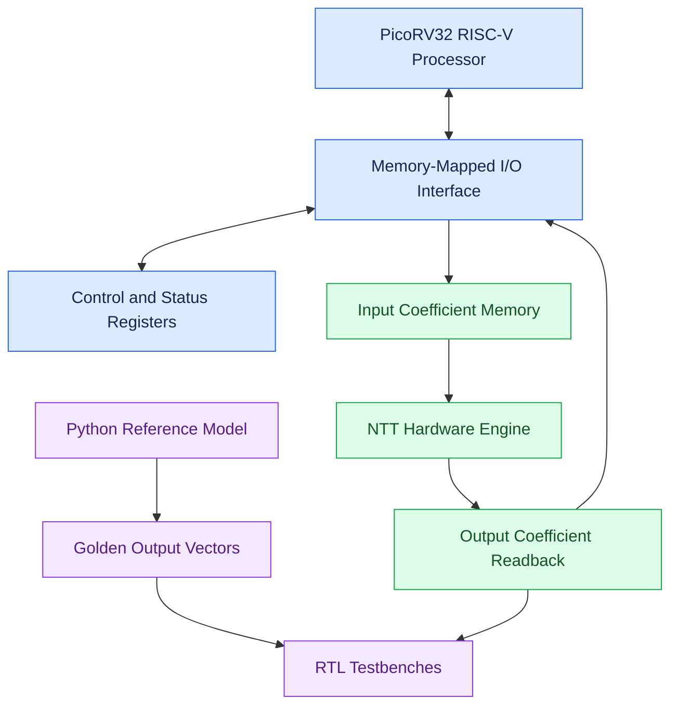
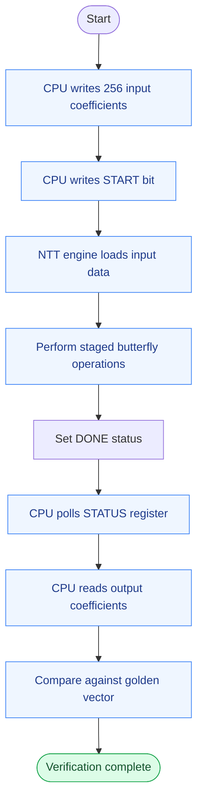
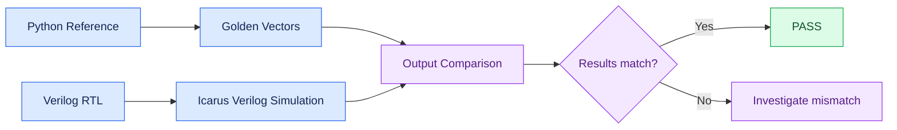

# ⚡ RISC-V Integrated Hardware Accelerator for NTT-Based Post-Quantum Cryptography

<p align="center">
  <strong>A RISC-V controlled hardware accelerator for fast, verified Number Theoretic Transform computation.</strong>
</p>

<p align="center">
  
  
  
  
</p>

---

## 🧠 Overview

This project integrates a **PicoRV32 RISC-V processor** with a custom Number Theoretic Transform (NTT) hardware accelerator through a memory-mapped I/O (MMIO) interface.

The accelerator processes 256 coefficients using modular arithmetic with the modulus \(q = 3329\). A Python reference implementation generates golden vectors, enabling functional verification of the RTL design against expected outputs.

The project combines processor control, hardware acceleration, modular arithmetic, and simulation-based verification in a single embedded hardware system.

## ✨ Key Features

- **RISC-V integration:** Software-driven accelerator control using PicoRV32.
- **NTT hardware engine:** A 256-coefficient transform with staged butterfly computation.
- **MMIO interface:** Memory-mapped control, status, input, and output registers.
- **Modular arithmetic:** Arithmetic operations over the modulus \(q = 3329\).
- **Python reference model:** Golden-vector generation for independent result checking.
- **Stress testing:** Verification with zero, single-nonzero, near-modulus, and deterministic-random input vectors.
- **End-to-end testing:** CPU-driven input loading, accelerator start, status polling, and output readback.

## 🏗️ System Architecture

The following diagram illustrates the major components and their interactions.



## 🔄 Accelerator Execution Flow

The processor controls the accelerator through the MMIO register interface.



## 🧮 NTT Engine

The Number Theoretic Transform is a finite-field transform used in polynomial arithmetic and cryptographic algorithms. It enables structured polynomial multiplication and related operations.

The current implementation uses:

| Parameter | Value |
|---|---|
| Transform length | 256 coefficients |
| Modulus | \(q = 3329\) |
| Coefficient width | 12 bits |
| Transform stages | 8 |
| Butterfly schedule | 128 down to 2 operations per stage |
| Twiddle factor root | 17 |
| Hardware verification | RTL simulation |

The accelerator is controlled through a start signal and reports its busy and completion states. Its output coefficients are available through the MMIO output register region.

> **Scope:** This project implements and verifies an NTT accelerator intended for post-quantum cryptography research. Full ML-KEM compliance, including all required transform conventions, surrounding cryptographic operations, and specification-level validation, is not claimed by this repository.

## 🗺️ MMIO Register Map

The MMIO interface exposes the following register regions.

| Register | Offset | Description |
|---|---:|---|
| CONTROL | `0x000` | Write bit 0 to start the accelerator when idle |
| STATUS | `0x004` | Bit 0: busy; bit 1: sticky completion status |
| Input coefficients | `0x100`–`0x4FC` | 256 coefficient locations |
| Output coefficients | `0x500`–`0x8FC` | 256 result locations |

The CPU integration test uses an MMIO base address of `0x1000`, making the first input and output coefficient addresses `0x1100` and `0x1500`, respectively.

## 🧪 Verification and Testing

Verification combines a Python reference implementation with RTL simulations using Icarus Verilog in EDA Playground.

### Test coverage

| Test | Result |
|---|---|
| All-zero input vector | ✅ Passed — 256 outputs matched |
| Single-nonzero input vector | ✅ Passed — 256 outputs matched |
| Near-modulus input vector | ✅ Passed — 256 outputs matched |
| Deterministic-random input vector | ✅ Passed — 256 outputs matched |
| MMIO-to-NTT regression | ✅ Passed — 256 outputs matched |
| PicoRV32 status polling | ✅ Passed in an earlier integration run |
| CPU output readback | ✅ Passed in an earlier integration run |
| Full CPU output verification | ✅ Previously passed — 256 output reads and RAM comparisons |

The full MMIO regression reported **zero output mismatches** against the Python golden vector. The CPU integration tests also previously verified processor-driven input writes, completion polling, output readback, and stored result values.

### Verification flow



## 📁 Repository Structure

```text
riscv-ntt-accelerator/
├── rtl/
│   ├── mlkem_ntt_engine.v
│   ├── ntt_accelerator_mmio.v
│   ├── ntt_butterfly.v
│   ├── ntt_butterfly_basic.v
│   ├── ntt_stage.v
│   ├── ntt_stage1.v
│   ├── ntt_stage2.v
│   ├── ntt_stage3.v
│   ├── ntt_twiddle_rom.v
│   ├── ntt_twiddle_lookup.v
│   ├── modular_adder.v
│   ├── modular_subtractor.v
│   └── modular_multiplier.v
├── software/
│   ├── ntt_reference.py
│   ├── compare_with_kyber.py
│   ├── ntt_independent_check.py
│   ├── generate_golden_vector.py
│   ├── generate_stress_vectors.py
│   ├── generate_random_testbench.py
│   ├── generate_twiddle_rom.py
│   ├── export_stress_vectors.py
│   └── stress_vectors/
├── testbench/
│   ├── modular_adder_tb.v
│   ├── modular_subtractor_tb.v
│   ├── modular_multiplier_tb.v
│   ├── ntt_butterfly_basic_tb.v
│   ├── ntt_butterfly_tb.v
│   └── ntt_stage_tb.v
├── results/
├── .gitignore
└── README.md
```

## 🛠️ Tools and Technologies

- **Verilog HDL** — RTL design and hardware modules
- **PicoRV32** — RISC-V processor core used in CPU integration simulations
- **Python** — Reference transform and golden-vector generation
- **Icarus Verilog** — HDL compilation and simulation
- **EDA Playground** — Online RTL verification environment
- **Git and GitHub** — Version control and project hosting

## ▶️ Running Simulations

The project RTL was verified in EDA Playground. A typical simulation command is:

```bash
iverilog -Wall -g2012 design.sv picorv32.v testbench.sv
vvp a.out
```

Here, `design.sv` contains the RTL modules, `picorv32.v` contains the processor source, and `testbench.sv` contains the selected testbench.

The EDA Playground file arrangement may differ from the local repository structure. The command above applies to the configured playground environment; it is not a guarantee that the same command works directly from the repository root.

Python reference and vector-generation scripts are available in `software/`. Install any dependencies required by the selected script before running it.

## 🚧 Current Scope and Future Work

Potential next steps include:

- [ ] Add reproducible local simulation scripts and test instructions.
- [ ] Add continuous integration for automated RTL and Python checks.
- [ ] Document synthesis results, timing, area, and resource utilization when measured.
- [ ] Expand randomized and boundary-case regression coverage.
- [ ] Validate the complete transform against the intended cryptographic specification.
- [ ] Evaluate FPGA implementation and hardware integration.

## ⚠️ Limitations

The current results establish functional behavior under the tested simulation conditions. They do not independently establish synthesis timing, power consumption, area, FPGA implementation, or complete ML-KEM compliance. Physical hardware validation should be documented separately if performed.

## 📄 License

No license has been selected yet. Unless a license is added, the repository should not be assumed to grant permission to reuse, modify, or redistribute its contents.

---

<p align="center">
  <strong>RISC-V • Hardware Acceleration • Modular Arithmetic • Post-Quantum Cryptography</strong>
</p>
