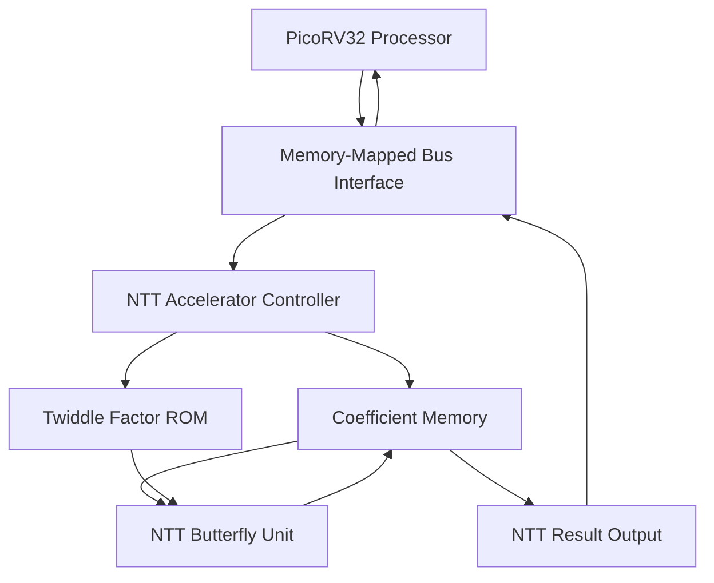
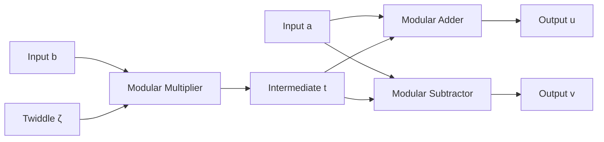
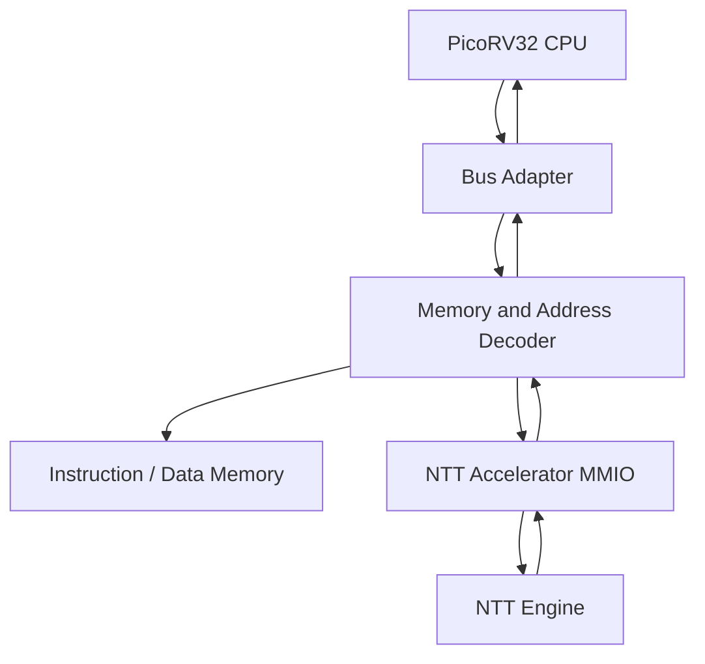
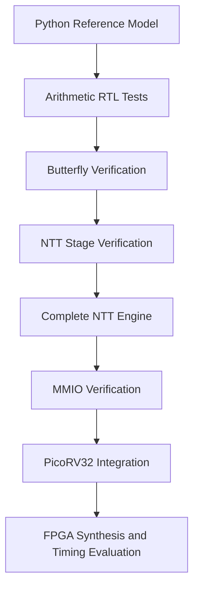

# RISC-V Integrated Hardware Accelerator for NTT-Based Post-Quantum Cryptography

**A RISC-V-integrated hardware accelerator for Number Theoretic Transform (NTT) computation using ML-KEM-related parameters.**

Verilog RTL · PicoRV32 · Python · Icarus Verilog · Yosys · nextpnr-ecp5

---

## Overview

This project develops and evaluates a hardware accelerator for NTT computation, a core mathematical operation used in lattice-based post-quantum cryptography.

The accelerator implements a 256-point Number Theoretic Transform using the ML-KEM parameter set. It is integrated with a PicoRV32 processor through a memory-mapped interface, allowing processor firmware to load coefficients, start the accelerator, monitor its status, and retrieve the computed results.

The project covers RTL design, software reference modelling, processor integration, functional verification, FPGA synthesis, and place-and-route evaluation.

## Key Features

- 256-point NTT datapath using ML-KEM-related parameters.
- Modular arithmetic over the prime field with \(q = 3329\).
- Reusable hardware butterfly processing unit.
- 128-entry twiddle-factor ROM.
- Dedicated NTT control and coefficient storage.
- Memory-mapped accelerator interface.
- PicoRV32 processor integration.
- Python-based reference verification.
- FPGA synthesis and ECP5 implementation evaluation.

## System Architecture

The design follows a processor-controlled accelerator architecture.



### Processing Sequence

1. The processor writes input coefficients into the accelerator interface.
2. The controller prepares the coefficient memory.
3. The processor issues the start command.
4. The NTT engine performs the transform through multiple stages.
5. The controller indicates completion.
6. The processor reads the output coefficients.

## Mathematical Foundation

The implementation uses the following ML-KEM-related parameters:

| Parameter | Value |
|---|---:|
| Transform size \(N\) | 256 |
| Modulus \(q\) | 3329 |
| Root of unity | 17 |
| Twiddle-factor entries | 128 |
| Coefficient width | 12 bits |

### NTT Butterfly Operation

The butterfly unit processes two input coefficients and a selected twiddle factor.

The intermediate product is:

$$
t = (b \cdot \zeta) \bmod q
$$

The two butterfly outputs are:

$$
u = (a+t) \bmod q
$$

$$
v = (a-t) \bmod q
$$

Here, \(a\) and \(b\) are input coefficients, and \(\zeta\) is the selected twiddle factor.

The modular arithmetic ensures that the results remain within the field defined by \(q = 3329\).

### Butterfly Datapath



## Hardware Design

The RTL is organized into modular components so that arithmetic operations, transform control, and processor communication can be developed and verified independently.

| Module | Responsibility |
|---|---|
| `modular_adder.v` | Modular addition |
| `modular_subtractor.v` | Modular subtraction |
| `modular_multiplier.v` | Modular multiplication |
| `ntt_butterfly.v` | Butterfly computation |
| `ntt_twiddle_rom.v` | Twiddle-factor storage |
| `mlkem_ntt_engine.v` | NTT stage execution and coefficient management |
| `ntt_accelerator_mmio.v` | Memory-mapped control and data interface |

### NTT Engine

The NTT engine uses a reusable butterfly unit to perform the transform across its stages.

Its main responsibilities include:

- Managing the transform state and stage progression.
- Selecting coefficient pairs.
- Supplying the appropriate twiddle factors.
- Performing butterfly operations.
- Writing the computed coefficients back to storage.
- Indicating transform completion.

### Input Coefficient Normalization

Input coefficients are normalized to the modulus before transform processing. This allows input values in the supported 12-bit range to be reduced into the field.

## RISC-V Processor Integration

The accelerator is integrated with the PicoRV32 processor through a memory-mapped interface.



### Processor-Controlled Operation

The processor firmware performs the following operations:

1. Loads the input coefficients.
2. Configures the accelerator.
3. Starts the NTT operation.
4. Polls the accelerator status.
5. Reads the transformed coefficients.
6. Compares the results against the expected reference output.

### Memory-Mapped Interface

The accelerator exposes control and coefficient-access regions through its MMIO interface.

| Register / Region | Offset | Purpose |
|---|---:|---|
| Control | `0x000` | Start and control operation |
| Status | `0x004` | Busy and completion status |
| Input coefficients | `0x100–0x4FC` | Input coefficient access |
| Output coefficients | `0x500–0x8FC` | Result coefficient access |

The coefficient regions contain 256 entries, with 32-bit processor-side accesses to the coefficient interface.

## Verification and Testing

Verification was performed at multiple levels, from arithmetic modules to complete processor-accelerator operation.

### Verification Flow



### Functional Verification Results

| Verification level | Test coverage | Result |
|---|---|---|
| Modular arithmetic | Addition, subtraction and multiplication | Passed |
| Butterfly unit | Multiple input and twiddle combinations | Passed |
| Twiddle ROM | 128 entries | Passed |
| NTT stages | 4 patterns × 384 butterflies = 1,536 operations | Passed |
| Complete NTT engine | 4 input patterns, 256 outputs each | Passed |
| MMIO interface | 4 input patterns | Passed |
| PicoRV32 integration | 5 input patterns, 256 outputs each | Passed |
| Input normalization | All 256 coefficient reductions | Passed |

### Processor-Level Test Patterns

The integrated processor and accelerator were verified using:

- All-zero coefficients.
- Deterministic nonzero coefficients.
- Single nonzero coefficient.
- Near-modulus coefficients.
- Deterministic random coefficients.

For each processor-level test pattern, all 256 hardware output coefficients were compared against the expected reference output.

**Result:** All five processor-level patterns passed the coefficient comparison.

The nonzero integration test completed at cycle 13,315, and the near-modulus integration test completed at cycle 12,941 in their respective simulations.

## FPGA Implementation Evaluation

The RTL was synthesized for FPGA implementation and evaluated using the ECP5 toolchain.

### ECP5 Synthesis Results

Target configuration: **ECP5-85K, CABGA381, speed grade 6**

| Resource | Used |
|---|---:|
| LUT4 | 23,707 |
| TRELLIS_FF | 6,194 |
| CCU2C | 1,988 |
| MULT18X18D | 2 |
| PFUMX | 5,098 |
| L6MUX21 | 68 |

### Place-and-Route Results

| Metric | Result |
|---|---:|
| Requested clock frequency | 50 MHz |
| Reported maximum frequency | 11.32 MHz |
| TRELLIS_COMB | 28,811 |
| TRELLIS_FF | 6,194 |
| MULT18X18D | 2 |
| DP16KD block RAM | 0 |

<details>
<summary><strong>Timing analysis</strong></summary>

The place-and-route report identified a critical path from the NTT engine control logic to coefficient-memory write logic.

The reported path delay was approximately **88.354 ns**.

- Routing delay: 59.208 ns
- Logic delay: 28.621 ns
- Clock-to-Q delay: 0.525 ns

Routing contributed the largest portion of the reported critical-path delay.

The implementation did not meet the requested 50 MHz target. The reported 11.32 MHz value is the tool's timing estimate for this implementation and configuration, not a measurement from a physical FPGA board.

</details>

### Implementation Observations

- The design successfully passed ECP5 synthesis.
- The current coefficient storage implementation maps primarily to flip-flops rather than embedded block RAM.
- The critical path includes arithmetic and coefficient-memory write logic.
- The current implementation provides a baseline for future area and timing optimization.

## Repository Structure

```text
riscv_ntt_accelerator/
│
├── software/
│   └── ntt_reference.py
│
├── rtl/
│   ├── modular_adder.v
│   ├── modular_subtractor.v
│   ├── modular_multiplier.v
│   ├── ntt_butterfly.v
│   ├── ntt_twiddle_rom.v
│   ├── mlkem_ntt_engine.v
│   └── ntt_accelerator_mmio.v
│
├── integration/
│   ├── picorv32.v
│   ├── picorv32_ntt_bus_adapter.v
│   ├── picorv32_ntt_memory.v
│   ├── picorv32_ntt_top.v
│   └── testbenches
│
├── firmware/
│
├── testbench/
│
├── results/
│   ├── synthesis reports
│   ├── place-and-route reports
│   └── implementation outputs
│
└── README.md
```

## Tools and Technologies

| Tool / Technology | Purpose |
|---|---|
| Verilog | Hardware description |
| PicoRV32 | RISC-V processor core |
| Python | Reference modelling and test generation |
| Icarus Verilog | RTL simulation |
| Yosys | Logic synthesis |
| nextpnr-ecp5 | FPGA placement and routing |
| ECP5 | FPGA implementation target |
| Git and GitHub | Version control and project hosting |

## Current Limitations

This project focuses on an NTT accelerator and its integration with a RISC-V processor. It is not a complete ML-KEM implementation or a complete FIPS 203 cryptographic processor.

The current implementation does not claim to implement the complete ML-KEM key-generation, encapsulation, or decapsulation workflows.

The FPGA timing evaluation also shows that the current design does not meet the requested 50 MHz target. Further optimization is required before claiming timing closure or physical hardware performance.

## Future Work

- Optimize the critical path and improve achievable clock frequency.
- Investigate efficient coefficient-memory architectures and block RAM inference.
- Evaluate alternative modular multiplication architectures.
- Improve resource utilization and datapath scheduling.
- Extend the design toward additional ML-KEM operations.
- Perform hardware validation on a physical FPGA board.
- Explore a more complete processor-driven post-quantum cryptographic accelerator.

## Project Scope

The project demonstrates the design and verification of a processor-integrated NTT hardware accelerator, from mathematical reference modelling through RTL implementation, functional testing, and FPGA implementation analysis.

It provides a foundation for further research into hardware acceleration for lattice-based post-quantum cryptography.
