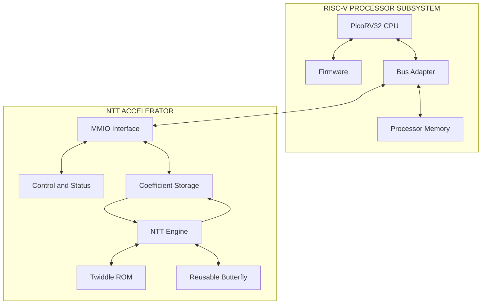
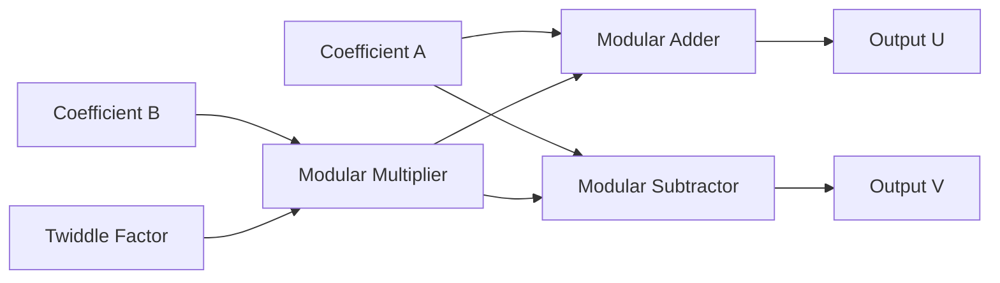
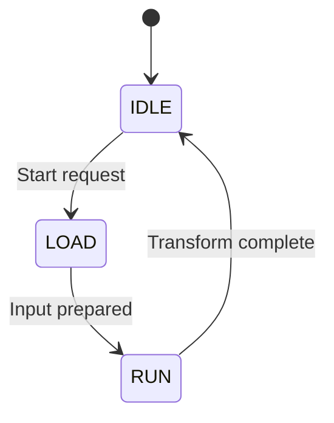
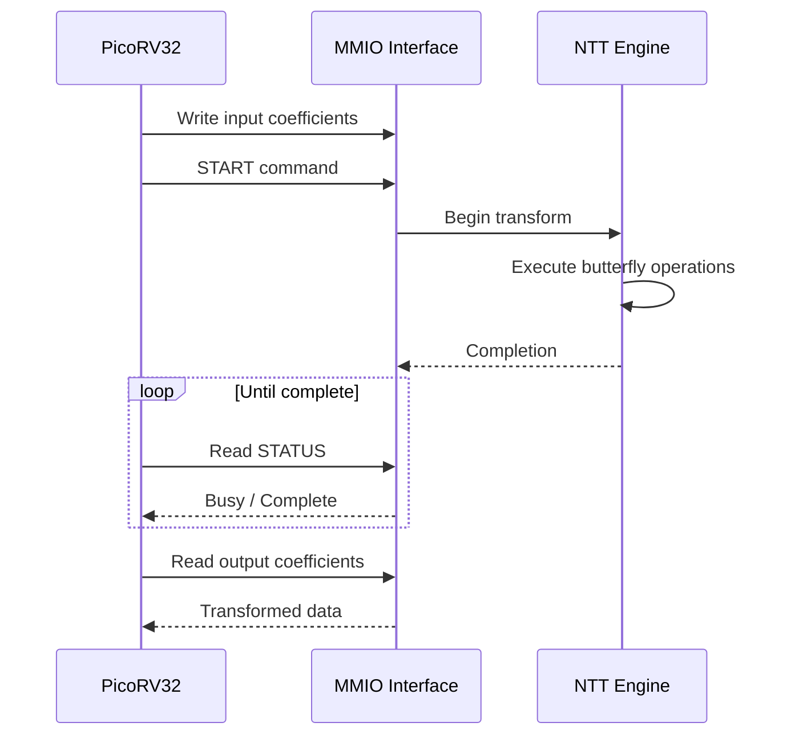
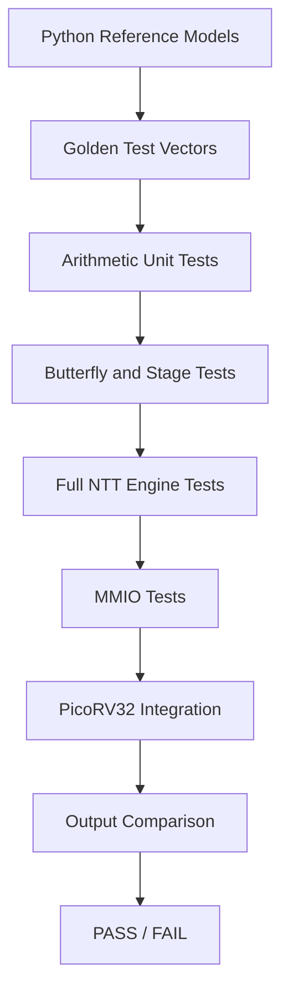

# RISC-V Integrated Hardware Accelerator for NTT-Based Post-Quantum Cryptography

<p align="center">

  **A RISC-V integrated hardware accelerator for NTT computation using ML-KEM-related parameters**

  <br/>

  Verilog RTL · PicoRV32 · Python · Icarus Verilog · Yosys · nextpnr-ecp5

</p>

---

## Overview

Post-quantum cryptography is driving the need for efficient hardware implementations of mathematical operations used in cryptographic algorithms.

This project explores the design of a **RISC-V-integrated Number Theoretic Transform (NTT) accelerator**, using parameters associated with ML-KEM (FIPS 203).

The accelerator implements a forward 256-coefficient NTT over:

\[
q=3329
\]

It combines a reusable butterfly datapath, modular arithmetic units, a twiddle-factor ROM, coefficient storage, an accelerator controller, and a memory-mapped interface.

A PicoRV32 processor executes firmware to configure the accelerator, transfer polynomial coefficients, initiate computation, and retrieve the results.

The design has been functionally verified through RTL simulations, Python reference comparisons, processor-level tests, and FPGA synthesis and place-and-route evaluation.

## Key Features

- 256-coefficient forward NTT engine.
- Modular addition, subtraction, and multiplication.
- 128-entry precomputed twiddle-factor ROM.
- Reusable butterfly datapath.
- Controller-driven transform execution.
- Memory-mapped accelerator interface.
- PicoRV32 RISC-V processor integration.
- Firmware-driven computation and output comparison.
- Python golden-reference verification.
- FPGA resource and timing evaluation using open-source tools.

---

## System Architecture

The design consists of three major subsystems:

1. **RISC-V processor:** Executes firmware and manages accelerator transactions.
2. **MMIO interface:** Handles control, status, and coefficient transfers.
3. **NTT engine:** Performs the transform using modular arithmetic hardware.

### High-level architecture



### NTT butterfly datapath

The engine uses a reusable butterfly unit to perform modular polynomial operations.



The butterfly computes:

\[
t=(b\cdot\zeta)\bmod q
\]

\[
u=(a+t)\bmod q
\]

\[
v=(a-t)\bmod q
\]

where \(a,b\) are input coefficients and \(\zeta\) is the selected twiddle factor.

---

## Hardware Design

| Parameter | Configuration |
|---|---|
| Transform length | 256 coefficients |
| Modulus | 3329 |
| Coefficient width | 12 bits |
| Twiddle-generation root | 17 |
| Twiddle ROM | 128 entries |
| Transform schedule | Cooley–Tukey DIT |
| Butterfly architecture | Reusable datapath |
| Controller states | IDLE, LOAD, RUN |

### Main RTL modules

| Module | Function |
|---|---|
| `mlkem_ntt_engine.v` | Transform controller and computation engine |
| `modular_adder.v` | Modular addition |
| `modular_subtractor.v` | Modular subtraction |
| `modular_multiplier.v` | Modular multiplication |
| `ntt_butterfly.v` | Butterfly computation |
| `ntt_twiddle_rom.v` | Precomputed twiddle factors |
| `ntt_accelerator_mmio.v` | Memory-mapped control and data interface |

### Controller flow



The controller sequences coefficient loading and butterfly execution while managing the transform operation.

---

## RISC-V Processor Integration

The accelerator is integrated with the **PicoRV32 RISC-V processor** through a bus adapter and memory-mapped interface.

The processor executes firmware that:

1. Initializes the input polynomial.
2. Writes 256 coefficients to the accelerator.
3. Issues the START command.
4. Polls the STATUS register.
5. Reads the 256 transformed coefficients.
6. Compares the outputs with expected results.

### Processor-to-accelerator transaction



### MMIO register map

| Offset | Access | Description |
|---|---|---|
| `0x000` | Write | CONTROL — bit 0 starts the accelerator |
| `0x004` | Read | STATUS — bit 0 busy, bit 1 complete |
| `0x100–0x4FC` | Write | Input coefficient registers |
| `0x500–0x8FC` | Read | Output coefficient registers |

The accelerator is mapped at processor base address `0x1000`.

The interface is a simple synchronous MMIO implementation, not an AXI, AHB, or Wishbone interface.

---

## Verification and Results

Verification was performed at multiple levels, from arithmetic units to complete processor-driven accelerator execution.

### Verification flow



### Functional verification summary

| Verification level | Recorded result |
|---|---|
| Python comparison with `kyber-py` | 6/6 vectors passed |
| Independent reference checks | 5/5 vectors passed |
| Stress-vector generation | 4/4 vectors generated |
| HEX vector export | 8/8 memory files generated |
| NTT stage verification | 1,536 butterfly operations, zero mismatches |
| Full NTT engine | 4 input patterns passed |
| MMIO verification | Tested patterns passed |
| PicoRV32 integration | 5 input patterns passed |

### Processor-level test coverage

| Input pattern | Result |
|---|---|
| All-zero | PASS |
| Deterministic nonzero | PASS |
| Single-nonzero | PASS |
| Near-modulus | PASS |
| Deterministic random | PASS |

All 256 output coefficients were compared against the corresponding expected results for each recorded processor-level test pattern.

Additional local regression results:

- Nonzero integration: 256/256 outputs matched.
- Near-modulus integration: 256/256 outputs matched.
- Input coefficient normalization: 256/256 coefficients verified.

---

## FPGA Implementation Evaluation

The design was evaluated using open-source FPGA implementation tools.

**Toolchain:** Yosys for synthesis and nextpnr-ecp5 for placement and routing.

### Target configuration

| Parameter | Value |
|---|---|
| FPGA family | Lattice ECP5 |
| Device class | 85K |
| Package | CABGA381 |
| Speed grade | 6 |
| Requested frequency | 50 MHz |

### Synthesis resource utilization

| Resource | Utilization |
|---|---:|
| LUT4 | 23,707 |
| TRELLIS_FF | 6,194 |
| MULT18X18D | 2 |
| DP16KD block RAM | 0 |

The coefficient storage mapped to registers rather than dedicated block RAM in the evaluated implementation.

### Timing evaluation

<PRIVATE_DATE>

| Metric | Result |
|---|---:|
| Requested frequency | 50 MHz |
| Tool-reported Fmax | 11.318 MHz |
| Critical path delay | 88.354 ns |
| Routing contribution | 59.208 ns |
| Timing target | Not met |

The critical path extended from transform control logic through butterfly multiplication and coefficient-memory write logic.

Routing accounted for approximately 67% of the reported critical path delay.

**Engineering observation:** The current implementation successfully passed synthesis and placement-and-routing evaluation, but did not meet the requested 50 MHz target. The reported frequency is a tool estimate, not a physical FPGA measurement.

---

## Repository Structure

```text
riscv-ntt-accelerator/
│
├── rtl/
│   ├── mlkem_ntt_engine.v
│   ├── modular_adder.v
│   ├── modular_subtractor.v
│   ├── modular_multiplier.v
│   ├── ntt_butterfly.v
│   ├── ntt_twiddle_rom.v
│   └── ntt_accelerator_mmio.v
│
├── integration/
│   ├── picorv32.v
│   ├── picorv32_ntt_bus_adapter.v
│   ├── picorv32_ntt_memory.v
│   └── picorv32_ntt_top.v
│
├── firmware/
│   ├── main.c
│   ├── start.S
│   ├── linker.ld
│   └── *.hex
│
├── software/
│   ├── ntt_reference.py
│   ├── compare_with_kyber.py
│   ├── ntt_independent_check.py
│   └── stress_vectors/
│
├── testbench/
│   ├── modular_adder_tb.v
│   ├── modular_subtractor_tb.v
│   ├── modular_multiplier_tb.v
│   ├── ntt_butterfly_tb.v
│   └── ntt_stage_tb.v
│
└── README.md
```

The repository also contains additional integration testbenches, vector-generation utilities, and generated verification data.

---

## Tools and Technologies

| Area | Technology |
|---|---|
| Hardware description | Verilog |
| Processor architecture | RISC-V |
| CPU core | PicoRV32 |
| Software reference | Python |
| Independent reference | kyber-py |
| RTL simulation | Icarus Verilog |
| Synthesis | Yosys |
| FPGA implementation | nextpnr-ecp5 |
| Firmware | C and RISC-V assembly |
| Version control | Git and GitHub |

---

## Current Scope and Future Work

### Implemented

- Forward 256-coefficient NTT engine.
- Modular arithmetic and butterfly datapath.
- Twiddle-factor ROM.
- MMIO accelerator interface.
- PicoRV32 processor integration.
- Firmware-driven computation.
- Software-reference and RTL verification.
- FPGA synthesis and placement-and-routing evaluation.

### Future improvements

- Critical-path and timing optimization.
- Improved coefficient-memory architecture and block RAM inference.
- Datapath pipelining.
- Inverse NTT support.
- Expanded verification and regression coverage.
- Physical FPGA board validation.
- Power evaluation.

**Scope note:** This project is an NTT hardware-acceleration implementation using ML-KEM-related parameters. It is not a complete FIPS 203 implementation and does not claim full ML-KEM cryptographic compliance or physical hardware validation.

---

## License

This repository is intended for academic and engineering evaluation. A project-level open-source license has not yet been selected. Third-party components retain their respective licensing terms.

---

<p align="center">

  **RISC-V × Hardware Acceleration × Post-Quantum Cryptography**

  *Exploring efficient hardware architectures for polynomial computation.*

</p>
