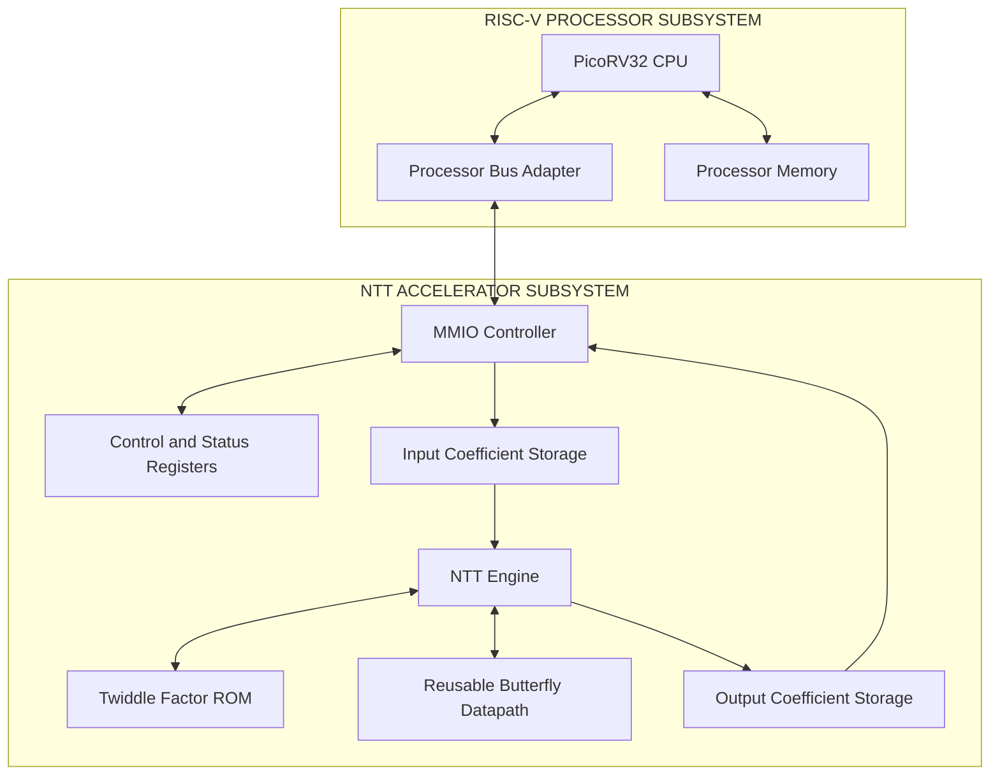
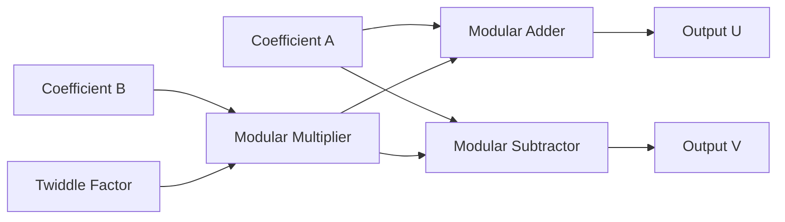
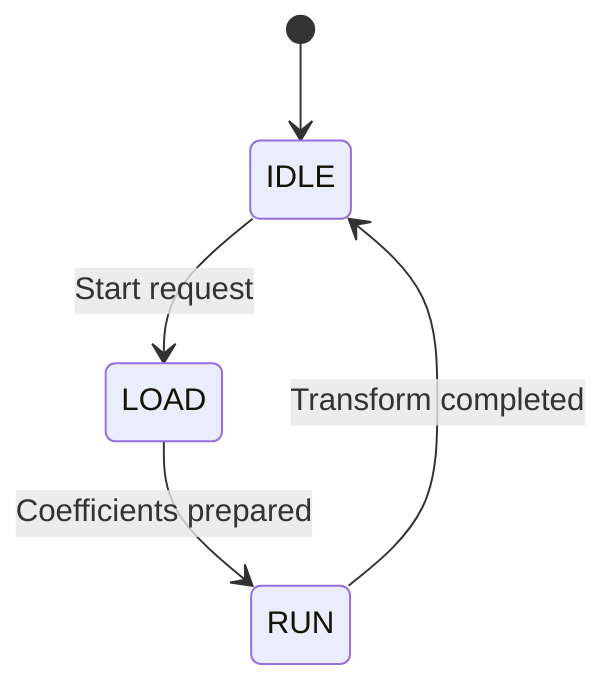
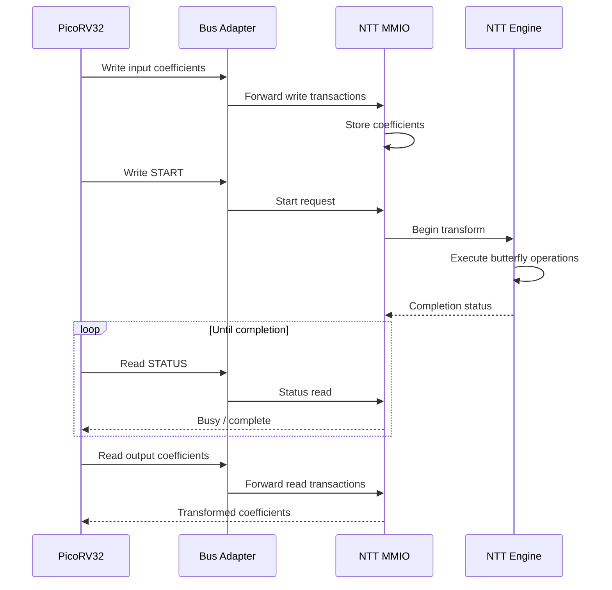
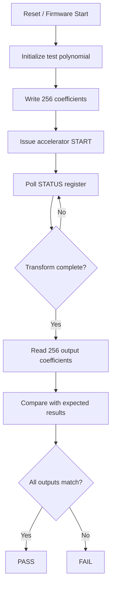

# RISC-V Integrated Hardware Accelerator for NTT-Based Post-Quantum Cryptography

**A processor-integrated hardware accelerator for polynomial Number Theoretic Transform (NTT) computation, designed around ML-KEM parameters and evaluated through RTL simulation, RISC-V integration, and FPGA implementation tools.**

<p align="center">

**Verilog RTL | PicoRV32 | Memory-Mapped I/O | Python Verification | Yosys | nextpnr-ecp5**

</p>

---

## 1. Project Overview

Post-quantum cryptography (PQC) algorithms are designed to remain secure against attacks from classical and quantum computers. One standardized post-quantum key encapsulation mechanism is **ML-KEM (Module-Lattice-Based Key-Encapsulation Mechanism)**, specified in FIPS 203.

Polynomial arithmetic is a fundamental computational component of ML-KEM. The Number Theoretic Transform (NTT) enables efficient polynomial-domain operations and is an important candidate for hardware acceleration.

This project develops a **RISC-V-integrated NTT hardware accelerator** using Verilog RTL and a PicoRV32 processor.

The accelerator implements a forward 256-coefficient NTT using the finite-field modulus:

$$
q=3329
$$

The architecture includes modular arithmetic units, a reusable butterfly datapath, precomputed twiddle factors, a transform controller, coefficient storage, and a synchronous memory-mapped interface.

The design is evaluated using Python reference models, golden test vectors, RTL simulation, processor-level firmware integration, and FPGA synthesis and place-and-route tools.

### Project Highlights

- 256-coefficient forward NTT hardware engine.
- Modular addition, subtraction, and multiplication units.
- 128-entry precomputed twiddle-factor ROM.
- Reusable butterfly datapath sequenced across transform stages.
- Synchronous memory-mapped accelerator interface.
- Integration with the PicoRV32 RISC-V processor.
- Firmware-driven accelerator execution and result verification.
- Python reference verification and independent `kyber-py` comparisons.
- FPGA synthesis and ECP5 placement-and-routing evaluation.

---

## 2. System Architecture

The design is organized into three major subsystems:

1. **Processor subsystem:** Executes firmware and manages accelerator transactions.
2. **Accelerator interface:** Handles control registers, status reporting, and coefficient transfers.
3. **NTT computation engine:** Performs modular arithmetic and transform operations.

### High-Level Architecture



The processor and accelerator operate as separate hardware blocks. The processor handles instruction execution, data movement, and control, while the accelerator performs the transform computation.

### Accelerator Datapath

The NTT engine uses a shared butterfly datapath rather than instantiating a separate butterfly for every coefficient pair.



The butterfly computes:

$$
t=(b\cdot\zeta)\bmod q
$$

$$
u=(a+t)\bmod q
$$

$$
v=(a-t)\bmod q
$$

where:

- $a$ and $b$ are input coefficients.
- $\zeta$ is the selected twiddle factor.
- $q=3329$ is the modulus.
- $u$ and $v$ are the butterfly outputs.

---

## 3. NTT Engine Design

### Transform Parameters

| Parameter | Value |
|---|---|
| Transform length | 256 coefficients |
| Modulus $q$ | 3329 |
| Coefficient width | 12 bits |
| Twiddle-generation root | 17 |
| Twiddle ROM depth | 128 entries |
| Transform schedule | Cooley-Tukey DIT |
| Controller states | IDLE, LOAD, RUN |
| Butterfly architecture | One reusable datapath |

### Main Hardware Components

| Module | Responsibility |
|---|---|
| `mlkem_ntt_engine.v` | Coordinates coefficient storage, transform scheduling, and butterfly execution |
| `modular_adder.v` | Modular addition |
| `modular_subtractor.v` | Modular subtraction |
| `modular_multiplier.v` | Modular multiplication |
| `ntt_butterfly.v` | Modular butterfly datapath |
| `ntt_butterfly_basic.v` | Basic butterfly implementation |
| `ntt_twiddle_rom.v` | Precomputed twiddle-factor storage |
| `ntt_twiddle_lookup.v` | Twiddle-factor lookup |
| `ntt_stage.v` | Stage-level transform logic |
| `ntt_stage1.v` | First stage implementation |
| `ntt_stage2.v` | Second stage implementation |
| `ntt_stage3.v` | Third stage implementation |
| `ntt_accelerator_mmio.v` | Processor-accessible accelerator interface |

### Modular Arithmetic

The arithmetic units operate over the finite field:

$$
\mathbb{Z}_{3329}
$$

**Modular addition**

$$
r=(a+b)\bmod 3329
$$

The adder performs addition followed by modular correction.

**Modular subtraction**

$$
r=(a-b)\bmod 3329
$$

The subtractor performs subtraction followed by modular correction.

**Modular multiplication**

$$
r=(a\times b)\bmod 3329
$$

The multiplier uses a 24-bit intermediate product before modular reduction.

### Twiddle Factor Generation

The design uses a precomputed ROM containing 128 twiddle factors derived from the parameter:

$$
\zeta=17
$$

The ROM uses bit-reversed indexing for the transform schedule. Precomputing these values avoids generating powers of the root during accelerator execution.

### Controller Operation



| State | Function |
|---|---|
| `IDLE` | Waits for an accelerator start request |
| `LOAD` | Loads and prepares input coefficients |
| `RUN` | Executes the scheduled transform operations |

The controller sequences the reusable butterfly across the transform schedule.

---

## 4. RISC-V Processor Integration

A major feature of this project is integrating the accelerator with a RISC-V processor rather than evaluating the NTT engine in isolation.

The processor integration uses **PicoRV32**, a compact RISC-V CPU implementation.

### Processor-to-Accelerator Data Flow



### Processor Integration Components

| File | Description |
|---|---|
| `picorv32.v` | PicoRV32 processor core |
| `picorv32_ntt_bus_adapter.v` | Connects processor bus transactions to memory and accelerator |
| `picorv32_ntt_memory.v` | Processor memory interface |
| `picorv32_ntt_top.v` | Top-level processor and accelerator integration |
| `picorv32_ntt_integration_tb.v` | Processor-level integration testbench |
| `picorv32_ntt_nonzero_tb.v` | Nonzero-input integration testbench |
| `picorv32_ntt_near_modulus_tb.v` | Near-modulus integration testbench |
| `ntt_load_reduction_tb.v` | Coefficient normalization verification |

### MMIO Register Interface

The accelerator is controlled using a synchronous memory-mapped interface.

| Signal | Direction | Description |
|---|---|---|
| `clk` | Input | System clock |
| `rst` | Input | Reset |
| `wr_en` | Input | Write enable |
| `rd_en` | Input | Read enable |
| `addr[11:0]` | Input | Register address |
| `wdata[31:0]` | Input | Write data |
| `rdata[31:0]` | Output | Read data |

This is a custom synchronous MMIO interface, not an AXI, AHB, or Wishbone implementation.

#### Accelerator Register Map

| Register Offset | Access | Description |
|---|---|---|
| `0x000` | Write | CONTROL: bit 0 starts the accelerator when idle |
| `0x004` | Read | STATUS: bit 0 indicates busy; bit 1 indicates completion |
| `0x100-0x4FC` | Write | 256 input coefficient registers |
| `0x500-0x8FC` | Read | 256 output coefficient registers |

Each coefficient occupies a 32-bit word-aligned register. The coefficient value is stored in bits `[11:0]`.

#### PicoRV32 Address Map

The accelerator is decoded at base address `0x1000` in the processor integration.

| Processor Address | Function |
|---|---|
| `0x1000` | CONTROL |
| `0x1004` | STATUS |
| `0x1100-0x14FC` | Input coefficients |
| `0x1500-0x18FC` | Output coefficients |

---

## 5. Firmware and Software Verification

The processor firmware performs the accelerator transaction from coefficient loading to output comparison.

### Firmware Execution Flow



The firmware is responsible for:

1. Initializing the input polynomial.
2. Writing the input coefficients to the accelerator.
3. Starting the transform.
4. Polling the status register.
5. Reading the 256 output coefficients.
6. Comparing hardware outputs against expected results.

### Software Reference Environment

Python reference models and generated test vectors provide an independent verification path.

The project uses `kyber-py` for reference comparisons.

The software directory includes:

- Reference NTT implementation.
- Independent comparison scripts.
- Golden-vector generation.
- Stress-vector generation.
- Twiddle ROM generation.
- Verilog test-vector generation.
- Random testbench generation.

---

## 6. Verification Methodology and Results

Verification covers arithmetic, butterfly operation, stage-level computation, full NTT execution, MMIO behavior, and processor integration.

### 6.1 Software Reference Verification

Previously recorded software checks include:

| Test | Recorded Result |
|---|---|
| Python reference comparison with `kyber-py` | PASS - 6/6 vectors |
| Independent reference checks | PASS - 5/5 vectors |
| Stress-vector generation | PASS - 4/4 vectors |
| HEX vector export | PASS - 8/8 memory files |
| Random testbench generation | PASS |

These are separate software checks, not a single combined hardware regression.

### 6.2 Arithmetic and Butterfly Verification

The modular arithmetic units were tested with boundary values and representative input combinations.

Verification covered:

- Modular addition.
- Modular subtraction.
- Modular multiplication.
- Butterfly sum and difference outputs.
- Twiddle-factor multiplication.

### 6.3 NTT Stage Verification

The `ntt_stage128` stage-level testbench evaluates five deterministic input patterns:

1. All-zero coefficients.
2. All coefficients set to 3328.
3. Sequential coefficient values.
4. Mixed deterministic coefficient values.
5. Alternating boundary values (0 and 3328).

Each pattern checks 128 butterfly operations, giving:

$$
5\times128=640
$$

**Recorded result: Zero mismatches across all 640 butterfly checks.**

This is a stage-level verification result and should not be confused with a complete multi-stage transform regression.

### 6.4 Full NTT Engine Verification

The complete NTT engine was evaluated using four input patterns:

| Input Pattern | Purpose |
|---|---|
| All-zero | Checks zero-input behavior |
| Single-nonzero | Checks a sparse input case |
| Near-modulus | Checks coefficient boundary handling |
| Deterministic random | Checks varied coefficient combinations |

The recorded full-engine regression compared all 256 output coefficients for each tested pattern against software-generated golden references.

**Previously recorded result: All four test patterns passed with zero output mismatches.**

### 6.5 MMIO Verification

The MMIO interface was tested for:

- Input coefficient writes.
- Accelerator start control.
- Busy-status reporting.
- Completion-status reporting.
- Output coefficient readback.
- Comparison with expected NTT results.

### 6.6 PicoRV32 Integration Verification

Processor-level testbenches validate firmware-driven execution of the NTT accelerator.

| Testbench | Expected reference | Verification |
|---|---|---|
| `picorv32_ntt_integration_tb.v` | `expected_ntt.hex` | 256 output coefficients |
| `picorv32_ntt_nonzero_tb.v` | `expected_ntt.hex` | 256 output coefficients |
| `picorv32_ntt_near_modulus_tb.v` | `expected_ntt_near_modulus.hex` | 256 output coefficients |

The first two testbenches reference the same expected-output file; they should not be counted as two distinct input patterns without additional evidence.

Each testbench checks firmware completion, processor trap status, and hardware output coefficients against the expected reference.

Previously recorded successful integration runs include:

- Nonzero-input integration: **13,315 cycles**.
- Near-modulus integration: **12,941 cycles**.

The repository also contains additional firmware source programs for zero, single-nonzero, nonzero, random, and near-modulus test cases. The presence of firmware source files does not by itself establish that every program has been executed in processor-level simulation.

---

## 7. FPGA Synthesis and Implementation Evaluation

The accelerator was evaluated using open-source FPGA implementation tools:

- **Yosys** for RTL synthesis.
- **nextpnr-ecp5** for ECP5 placement and routing.

The evaluation estimates hardware resource usage and analyzes the timing characteristics of the integrated design.

### FPGA Target Configuration

| Parameter | Configuration |
|---|---|
| FPGA family | Lattice ECP5 |
| Device class | 85K |
| Package | CABGA381 |
| Speed grade | 6 |
| Requested clock frequency | 50 MHz |

### Synthesis Resource Utilization

Previously recorded synthesis metrics:

| Resource | Reported Utilization |
|---|---:|
| LUT4 | 23,707 |
| TRELLIS_FF | 6,194 |
| CCU2C | 1,988 |
| MULT18X18D | 2 |
| PFUMX | 5,098 |
| DP16KD block RAM | 0 |

The coefficient storage mapped to registers rather than dedicated ECP5 block RAM in the evaluated implementation.

### Place-and-Route Timing Results

| Metric | Result |
|---|---:|
| Requested frequency | 50 MHz |
| Tool-reported Fmax | 11.318 MHz |
| Timing target | Not met |
| Critical path delay | 88.354 ns |
| Routing contribution | 59.208 ns |
| Routing share of critical path | Approximately 67% |

### Critical Path Analysis

The reported critical path extended from the NTT engine's group-start register to a coefficient-memory register. The path included butterfly multiplication and coefficient-memory write logic.


Routing delay contributed approximately 67% of the reported critical-path delay. This makes both datapath logic and interconnect organization important optimization targets.

### Interpretation

The design completed synthesis and placement-and-routing evaluation, but **did not meet the requested 50 MHz timing target**.

The reported Fmax of 11.318 MHz is a tool-estimated result for the selected target and implementation configuration. It is not a measurement from a physical FPGA board.

The numerical metrics above are previously obtained tool results. Detailed machine-generated synthesis and timing reports will be added to the repository under `results/` to make these claims independently reproducible.

No physical FPGA board validation, power measurement, or silicon measurement is claimed.

---

## 8. Repository Structure

```text
riscv-ntt-accelerator/
|
|-- README.md
|-- rtl/
|   |-- mlkem_ntt_engine.v
|   |-- modular_adder.v
|   |-- modular_subtractor.v
|   |-- modular_multiplier.v
|   |-- ntt_butterfly.v
|   |-- ntt_butterfly_basic.v
|   |-- ntt_twiddle_rom.v
|   |-- ntt_twiddle_lookup.v
|   |-- ntt_accelerator_mmio.v
|   |-- ntt_stage.v
|   |-- ntt_stage1.v
|   |-- ntt_stage2.v
|   `-- ntt_stage3.v
|
|-- integration/
|   |-- picorv32.v
|   |-- picorv32_ntt_bus_adapter.v
|   |-- picorv32_ntt_memory.v
|   |-- picorv32_ntt_top.v
|   |-- picorv32_ntt_integration_tb.v
|   |-- picorv32_ntt_nonzero_tb.v
|   |-- picorv32_ntt_near_modulus_tb.v
|   `-- ntt_load_reduction_tb.v
|
|-- firmware/
|   |-- main.c
|   |-- main_zero_test.c
|   |-- main_single_nonzero.c
|   |-- main_nonzero_test.c
|   |-- main_near_modulus.c
|   |-- main_random_test.c
|   |-- start.S
|   |-- linker.ld
|   |-- firmware.hex
|   |-- firmware_near_modulus.hex
|   `-- expected output and input vector files
|
|-- software/
|   |-- ntt_reference.py
|   |-- compare_with_kyber.py
|   |-- ntt_independent_check.py
|   |-- generate_golden_vector.py
|   |-- generate_stress_vectors.py
|   |-- export_stress_vectors.py
|   |-- generate_twiddle_rom.py
|   |-- generate_verilog_vector.py
|   `-- stress_vectors/
|
|-- testbench/
|   |-- modular_adder_tb.v
|   |-- modular_subtractor_tb.v
|   |-- modular_multiplier_tb.v
|   |-- ntt_butterfly_basic_tb.v
|   |-- ntt_butterfly_tb.v
|   `-- ntt_stage_tb.v
|
`-- results/
    `-- Implementation reports to be added
```

Generated `.bin`, `.elf`, and `.map` build artifacts are excluded from version control. Tracked HEX files are retained for firmware initialization and simulation.

---

## 9. Reproducing the Verification

### Prerequisites

- Python 3.8 or later.
- Icarus Verilog (`iverilog` and `vvp`).
- Yosys.
- nextpnr with ECP5 support.
- `kyber-py` for independent software-reference comparison.

Install the Python reference package:

```bash
pip install kyber-py
```

### Python Verification

Run from the repository root:

```bash
python software/compare_with_kyber.py

python software/ntt_independent_check.py

python software/generate_stress_vectors.py

python software/export_stress_vectors.py

python software/generate_random_testbench.py
```

### RTL Arithmetic Unit Simulations

**Modular adder**

```bash
iverilog -g2012 -o results/adder.vvp rtl/modular_adder.v testbench/modular_adder_tb.v
vvp results/adder.vvp
```

**Modular subtractor**

```bash
iverilog -g2012 -o results/subtractor.vvp rtl/modular_subtractor.v testbench/modular_subtractor_tb.v
vvp results/subtractor.vvp
```

**Modular multiplier**

```bash
iverilog -g2012 -o results/multiplier.vvp rtl/modular_multiplier.v testbench/modular_multiplier_tb.v
vvp results/multiplier.vvp
```

**Butterfly datapath**

```bash
iverilog -g2012 -o results/butterfly.vvp rtl/modular_adder.v rtl/modular_subtractor.v rtl/modular_multiplier.v rtl/ntt_butterfly.v testbench/ntt_butterfly_tb.v
vvp results/butterfly.vvp
```

### PicoRV32 Integration Simulation

Run from the repository root.

**Default integration test**

```bash
iverilog -g2012 -o integration_test.vvp integration/picorv32.v integration/picorv32_ntt_bus_adapter.v integration/picorv32_ntt_memory.v rtl/modular_adder.v rtl/modular_subtractor.v rtl/modular_multiplier.v rtl/ntt_butterfly.v rtl/ntt_twiddle_rom.v rtl/mlkem_ntt_engine.v rtl/ntt_accelerator_mmio.v integration/picorv32_ntt_top.v integration/picorv32_ntt_integration_tb.v

vvp integration_test.vvp
```

**Near-modulus integration test**

```bash
iverilog -g2012 -o near_modulus_test.vvp integration/picorv32.v integration/picorv32_ntt_bus_adapter.v integration/picorv32_ntt_memory.v rtl/modular_adder.v rtl/modular_subtractor.v rtl/modular_multiplier.v rtl/ntt_butterfly.v rtl/ntt_twiddle_rom.v rtl/mlkem_ntt_engine.v rtl/ntt_accelerator_mmio.v integration/picorv32_ntt_top.v integration/picorv32_ntt_near_modulus_tb.v

vvp near_modulus_test.vvp
```

The integration directory contains additional testbenches for nonzero-input and coefficient load-normalization checks.

---

## 10. Engineering Challenges and Design Considerations

### Reusable Datapath

Using one reusable butterfly reduces replicated arithmetic hardware. However, the controller must sequence operations and manage coefficient access correctly.

### Coefficient Storage

The current coefficient storage maps to registers rather than dedicated ECP5 block RAM in the evaluated implementation.

Dynamic coefficient indexing, coefficient loading, and output access are important considerations for future memory architecture optimization.

### Timing Performance

The placement-and-routing report identifies routing as the largest contributor to the critical path.

Potential improvements include:

- Replacing the current modular reduction implementation with a more hardware-efficient reduction architecture.
- Reducing long interconnect paths.
- Improving coefficient-memory organization.
- Introducing pipeline stages where appropriate.
- Optimizing control and write-enable logic.
- Evaluating alternative datapath schedules.

### Verification Across Abstraction Levels

Testing only arithmetic units would not establish that the processor can correctly control the accelerator.

The project therefore uses multiple verification levels:

- Arithmetic modules.
- Butterfly datapath.
- Stage-level transform logic.
- Complete NTT engine.
- MMIO interface.
- Processor-level firmware integration.
- Independent software-reference comparison.

---

## 11. Current Scope and Limitations

### Implemented

- Forward 256-coefficient NTT engine.
- Modular arithmetic datapath.
- Twiddle-factor ROM.
- Reusable butterfly architecture.
- Synchronous MMIO interface.
- PicoRV32 processor integration.
- Firmware-driven accelerator execution.
- Python reference and golden-vector verification.
- RTL and processor-level functional simulations.
- ECP5 synthesis and placement-and-routing evaluation.

### Not Yet Implemented or Validated

- Complete ML-KEM implementation.
- Complete inverse NTT and all remaining cryptographic operations required for FIPS 203.
- Physical FPGA board validation.
- Timing closure at the requested 50 MHz.
- Physical power measurements.
- Silicon-level validation.
- Dedicated block RAM mapping for coefficient storage.

**Cryptographic scope:** This project is an NTT hardware-acceleration implementation using ML-KEM-related parameters. It is not a complete FIPS 203 implementation and should not be treated as a production cryptographic device.

---

## 12. Future Development

| Area | Planned Direction |
|---|---|
| Modular arithmetic | Evaluate Barrett reduction and alternative modular reduction architectures |
| Timing optimization | Reduce critical-path delay and improve achievable frequency |
| Memory architecture | Investigate efficient block RAM inference |
| Datapath | Explore pipelining and improved coefficient access |
| Transform support | Add inverse NTT functionality |
| Processor integration | Explore standardized SoC interconnects such as AXI4-Lite |
| Verification | Expand automated regression coverage |
| FPGA evaluation | Perform physical board validation |
| Power analysis | Evaluate power consumption using supported implementation tools |

---

## 13. Tools and Technologies

| Category | Tools |
|---|---|
| Hardware description | Verilog |
| Processor | PicoRV32 RISC-V |
| Simulation | Icarus Verilog |
| Synthesis | Yosys |
| FPGA place and route | nextpnr-ecp5 |
| Software reference | Python |
| Independent reference | kyber-py |
| Firmware | C and RISC-V assembly |
| Version control | Git and GitHub |

---

## 14. License and Academic Use

This repository is intended for academic, educational, and engineering evaluation.

A formal project-level open-source license has not yet been selected. Third-party components, including the PicoRV32 core and reference software packages, retain their respective licensing terms. Consult their original repositories and package distributions before redistribution.

---

<p align="center">

**RISC-V × Hardware Acceleration × Post-Quantum Cryptography**

*Exploring hardware architectures for efficient polynomial computation.*

</p>
