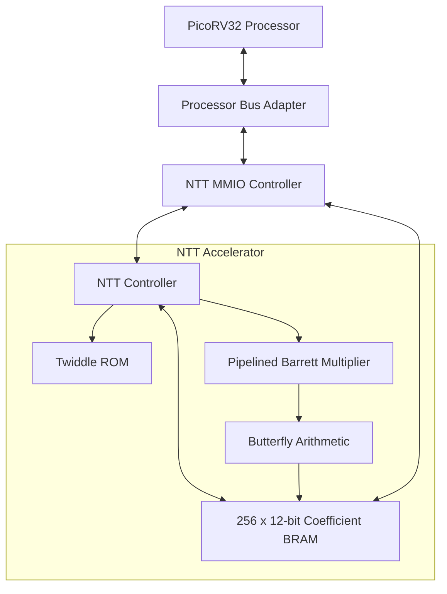

# RISC-V Integrated Hardware Accelerator for NTT-Based Post-Quantum Cryptography

**A PicoRV32-integrated hardware accelerator for 256-point Number Theoretic Transform (NTT) computation using ML-KEM parameters, BRAM-based coefficient storage and pipelined Barrett modular arithmetic.**

<p align="center">

**Verilog RTL · RISC-V · PicoRV32 · BRAM · Python · Yosys · nextpnr-ecp5**

</p>

---

## 1. Overview

The Number Theoretic Transform (NTT) is an important polynomial computation used in lattice-based post-quantum cryptography. This project implements a hardware-accelerated **256-point forward NTT** using parameters associated with ML-KEM (FIPS 203).

The accelerator is integrated with a PicoRV32 processor through a custom memory-mapped interface. Firmware loads polynomial coefficients, starts the transform and reads the resulting coefficients.

**Key specifications**

| Parameter | Value |
|---|---:|
| Transform length | 256 |
| Modulus \(q\) | 3329 |
| Coefficient width | 12 bits |
| Root parameter | 17 |
| Twiddle ROM | 128 entries |
| Transform stages | 7 |
| Total butterflies | 896 |
| Barrett constant \(\mu\) | 5039 |
| Multiplier latency | 8 cycles |

## 2. Hardware Architecture

The system consists of three main blocks:

- **PicoRV32 processor:** Executes firmware and manages accelerator transactions.
- **MMIO interface:** Handles control, status and coefficient access.
- **NTT engine:** Performs the transform using shared BRAM and pipelined arithmetic.



### Coefficient memory

The latest architecture uses a shared synchronous **256 × 12-bit, 1-read/1-write BRAM**.

- The processor loads input coefficients into the memory.
- The NTT engine reads and updates coefficients in place.
- The processor reads the transformed coefficients after completion.
- The controller initializes the memory after reset.

All 256 input coefficients must be reloaded before another independent transform.

### Butterfly computation

For coefficients \(a\) and \(b\), and twiddle factor \(\zeta\):

\[
t = (b \times \zeta) \bmod 3329
\]

\[
u = (a+t) \bmod 3329
\]

\[
v = (a-t) \bmod 3329
\]

The butterfly produces two output coefficients, \(u\) and \(v\).

### Pipelined Barrett multiplier

The multiplier performs modular multiplication:

\[
r = (a \times b) \bmod 3329
\]

It uses the Barrett reciprocal constant:

\[
\mu = 5039
\]

The arithmetic is divided into registered stages, producing an **8-cycle latency**. The NTT controller uses `PIPE_START` and `PIPE_WAIT` states to manage the multiplier and waits for its completion before writing butterfly results.

### NTT controller

The BRAM engine uses the following states:

`INIT → IDLE → READ_A → READ_B → PIPE_START → PIPE_WAIT → WRITE_U → WRITE_V`

The controller sequences the seven transform stages and all 896 butterfly operations.

---

## 3. PicoRV32 Integration and MMIO

The accelerator is connected to PicoRV32 through a custom synchronous bus adapter. It is not an AXI, AHB or Wishbone implementation.

**Processor execution flow**

1. Wait for accelerator initialization.
2. Write 256 input coefficients.
3. Issue the START command.
4. Poll the STATUS register.
5. Read 256 transformed coefficients.
6. Compare outputs against expected values.

### Accelerator register map

| Offset | Access | Description |
|---|---|---|
| `0x000` | Write | CONTROL — bit 0 starts the accelerator |
| `0x004` | Read | STATUS |
| `0x100–0x4FC` | Write | 256 input coefficient locations |
| `0x500–0x8FC` | Read | 256 output coefficient locations |

Each coefficient occupies a 32-bit word-aligned location. The coefficient value is stored in bits `[11:0]`.

**STATUS bits**

| Bit | Meaning |
|---|---|
| 0 | Busy |
| 1 | Completion status (sticky) |
| 2 | BRAM initialization complete |

**PicoRV32 accelerator base address:** `0x10000000`

| Processor address | Function |
|---|---|
| `0x10000000` | CONTROL |
| `0x10000004` | STATUS |
| `0x10000100–0x100004FC` | Input coefficients |
| `0x10000500–0x100008FC` | Output coefficients |

---

## 4. Verification and Results

Verification covers software reference calculations, arithmetic, the pipelined multiplier, the BRAM NTT engine and processor-level execution.

| Verification | Result |
|---|---|
| `kyber-py` reference comparison | PASS — 6/6 checks |
| Independent software checks | PASS — 5/5 checks |
| Barrett arithmetic exhaustive test | PASS — 11,082,241 operand pairs |
| Pipelined multiplier regression | PASS — 10,000 transactions |
| Multiplier latency | 8 cycles |
| BRAM NTT regression | PASS — 4 input patterns |
| BRAM output comparisons | 1,024 coefficients |
| Independent nonzero golden reference | PASS — zero mismatches |
| PicoRV32 integration | PASS — 4 input patterns |

### NTT input patterns

The BRAM regression covers:

- Deterministic nonzero coefficients.
- Near-modulus coefficients.
- Pseudo-random coefficients.
- All-zero coefficients.

All four patterns passed with zero reported coefficient mismatches.

### Processor integration

Firmware-driven simulations verified:

| Input pattern | Result |
|---|---|
| Zero | PASS — 256/256 coefficients |
| Nonzero | PASS — 256/256 coefficients |
| Near-modulus | PASS — 256/256 coefficients |
| Random | PASS — 256/256 coefficients |

The integration test checks firmware completion, processor trap status and accelerator output values.

These results establish functional simulation, not physical FPGA operation.

---

## 5. FPGA Implementation and PPA

The design was evaluated using **Yosys** for synthesis and **nextpnr-ecp5** for placement and routing.

**Target configuration:** Lattice ECP5 85K, CABGA381 package, speed grade 6.

### Latest pipelined implementation

| Resource | Utilization |
|---|---:|
| DP16KD block RAM | 1 |
| MULT18X18D DSP | 1 |
| LUT4 | 634 |
| TRELLIS_FF | 438 |
| CCU2C | 171 |
| L6MUX21 | 19 |
| PFUMX | 115 |

### Routed results

| Metric | Result |
|---|---:|
| Requested frequency | 50 MHz |
| Tool-reported Fmax | **78.7836 MHz** |
| Combinational cells | 1,064 |
| Flip-flops | 438 |
| I/O cells | 80 |

### Optimization comparison

| Architecture | Fmax | DSP | BRAM |
|---|---:|---:|---:|
| Original BRAM implementation | 15.2149 MHz | 1 | 1 |
| Barrett reduction | 25.9882 MHz | 4 | 1 |
| Shift/add Barrett | 27.0746 MHz | 1 | 1 |
| Pipelined Barrett | **78.7836 MHz** | **1** | **1** |

The pipelined implementation improved the reported routed frequency by approximately **5.18×** compared with the original BRAM implementation.

**Timing qualification:** The latest nextpnr run used unconstrained-I/O and timing-allow-fail options. The reported Fmax is an internal routed tool estimate, not proof of complete timing closure or operation on a physical FPGA board.

No physical board timing, power or silicon measurements are claimed.

---

## 6. Repository Structure

```text
riscv-ntt-accelerator/
|
|-- rtl/
|   |-- modular_adder.v
|   |-- modular_subtractor.v
|   |-- modular_multiplier.v
|   |-- modular_multiplier_barrett*.v
|   |-- modular_multiplier_barrett_pipe.v
|   |-- ntt_butterfly*.v
|   |-- ntt_twiddle_rom.v
|   |-- ntt_coeff_bram_1r1w.v
|   |-- mlkem_ntt_engine.v
|   |-- mlkem_ntt_bram_engine*.v
|   |-- ntt_accelerator_mmio*.v
|   |-- ntt_stage*.v
|
|-- integration/
|   |-- picorv32.v
|   |-- picorv32_ntt_memory.v
|   |-- picorv32_ntt_bram_top.v
|   |-- picorv32_ntt_bram_bus_adapter.v
|   |-- picorv32_ntt_bram_integration_tb.v
|   |-- mlkem_ntt_bram_barrett_pipe_regression_tb.v
|   |-- modular_multiplier_barrett_pipe_tb.v
|   |-- ntt_mmio_bram_pipe_control_tb.v
|
|-- firmware/
|   |-- main*.c
|   |-- start.S
|   |-- linker.ld
|   |-- *.hex
|   |-- expected_ntt_nonzero.hex
|
|-- software/
|   |-- ntt_reference.py
|   |-- compare_with_kyber.py
|   |-- ntt_independent_check.py
|   |-- generate_*.py
|
|-- testbench/
|   |-- arithmetic and butterfly testbenches
|
|-- results/
|   |-- .gitkeep
|
|-- README.md
```

The repository retains earlier implementations for comparison. The active architecture is the BRAM-based pipelined Barrett implementation.

---

## 7. Reproducing Verification

### Requirements

- Python 3.8+
- Icarus Verilog
- Yosys
- nextpnr-ecp5
- RISC-V GCC toolchain for firmware builds
- `kyber-py`

Install the reference package:

```bash
pip install kyber-py
```

Run the software reference checks from the repository root:

```bash
python software/compare_with_kyber.py
python software/ntt_independent_check.py
```

The primary RTL regression testbenches are:

| Testbench | Purpose |
|---|---|
| `integration/modular_multiplier_barrett_pipe_tb.v` | Pipelined multiplier |
| `integration/mlkem_ntt_bram_barrett_pipe_regression_tb.v` | Four-pattern BRAM NTT regression |
| `integration/ntt_mmio_bram_pipe_control_tb.v` | Pipelined MMIO control |
| `integration/picorv32_ntt_bram_integration_tb.v` | Processor-to-accelerator integration |

Compile each testbench with its corresponding RTL dependencies and run it using `vvp`.

---

## 8. Scope and Limitations

**Implemented**

- 256-point forward NTT using \(q=3329\).
- Seven-stage transform controller.
- Twiddle-factor ROM.
- Shared synchronous coefficient BRAM.
- Barrett modular arithmetic and pipelined multiplier.
- Custom MMIO interface.
- PicoRV32 processor integration.
- Firmware-driven execution.
- Python reference and RTL verification.
- ECP5 synthesis and place-and-route evaluation.

**Not implemented or validated**

- Complete ML-KEM key generation, encapsulation and decapsulation.
- Complete FIPS 203 implementation.
- Full inverse NTT and remaining cryptographic operations.
- Physical FPGA board demonstration.
- Board-level timing closure and external I/O validation.
- Measured power consumption or silicon validation.

This is an academic NTT hardware-acceleration project, not a complete or certified ML-KEM implementation or production cryptographic device.

---

## 9. Tools and Technologies

| Category | Tools |
|---|---|
| Hardware description | Verilog |
| Processor | PicoRV32 / RISC-V |
| Firmware | C, RISC-V assembly |
| Simulation | Icarus Verilog |
| Synthesis | Yosys |
| FPGA implementation | nextpnr-ecp5 |
| Software reference | Python, kyber-py |
| Version control | Git, GitHub |

---

## 10. License

A project-level open-source license has not yet been selected. Third-party components, including PicoRV32 and reference software packages, retain their respective licenses.

---

<p align="center">

**RISC-V × Hardware Acceleration × Post-Quantum Cryptography**

*Designing and evaluating a processor-integrated NTT accelerator.*

</p>
