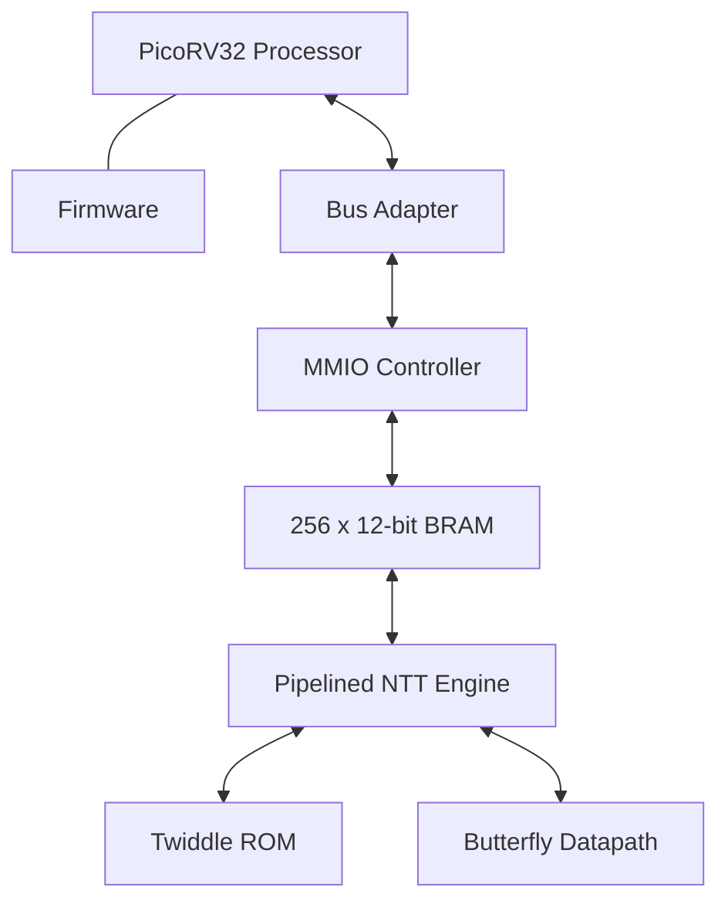

# RISC-V Integrated Hardware Accelerator for NTT-Based Post-Quantum Cryptography

A processor-integrated 256-point Number Theoretic Transform (NTT) accelerator using ML-KEM parameters, implemented in Verilog RTL and integrated with a PicoRV32 RISC-V processor.

**Verilog RTL · PicoRV32 · MMIO · BRAM · Barrett Reduction · Python · Yosys · nextpnr-ecp5**

---

## 1. Overview

This project implements a hardware accelerator for forward NTT computation, a key polynomial operation used in ML-KEM (FIPS 203).

The accelerator operates on 256 coefficients over the finite field with modulus $q = 3329$.

**Key features**
- Reusable butterfly datapath and 128-entry twiddle ROM.
- Eight-cycle pipelined Barrett modular multiplier.
- Synchronous 256 × 12-bit, single-read/single-write coefficient BRAM.
- Memory-mapped control and coefficient access.
- PicoRV32 integration with firmware-driven execution.
- Python reference verification and RTL simulation.
- ECP5 synthesis and place-and-route evaluation.

## 2. Architecture

The system consists of three main blocks:

1. **PicoRV32:** Executes firmware and manages accelerator transactions.
2. **MMIO controller:** Handles control, status, and coefficient transfers.
3. **NTT engine:** Performs transform operations using modular arithmetic, twiddle factors, and BRAM.



### NTT parameters

| Parameter | Value |
|---|---:|
| Transform length | 256 |
| Modulus $q$ | 3329 |
| Coefficient width | 12 bits |
| Twiddle root | 17 |
| Twiddle ROM | 128 entries |
| Transform schedule | Cooley–Tukey DIT |

### Butterfly operation

The butterfly computes:

$$t = (b \cdot \zeta) \bmod q$$

$$u = (a+t) \bmod q$$

$$v = (a-t) \bmod q$$

A reusable datapath performs the operations under controller sequencing.

## 3. Processor Integration

The accelerator is connected to PicoRV32 through a synchronous, project-specific MMIO interface. It is not an AXI, AHB, or Wishbone implementation.

| Processor address | Function |
|---|---|
| `0x1000` | CONTROL |
| `0x1004` | STATUS |
| `0x1100–0x14FC` | 256 input coefficients |
| `0x1500–0x18FC` | 256 output coefficients |

Firmware performs the following sequence:

1. Initializes and writes 256 input coefficients.
2. Starts the accelerator.
3. Polls the STATUS register.
4. Reads 256 output coefficients.
5. Compares the results with expected values.

## 4. Implementation

The final architecture includes:

- Modular addition and subtraction.
- Barrett modular multiplication with an eight-cycle pipeline.
- Precomputed twiddle-factor ROM.
- Synchronous 256 × 12-bit, 1R1W coefficient BRAM.
- Pipelined NTT engine and MMIO control.
- PicoRV32 processor and firmware integration.

The design uses ML-KEM-related parameters but implements the forward NTT accelerator, not the complete ML-KEM cryptographic algorithm.

## 5. Verification Results

Verification combines Python reference models, `kyber-py`, Icarus Verilog simulation, and processor-level firmware tests.

| Verification | Result |
|---|---|
| Barrett multiplier exhaustive checks | 11,082,241 pairs passed |
| Pipelined multiplier | 10,000 consecutive transactions passed |
| NTT stage regression | 1,536 butterfly operations, zero mismatches |
| BRAM NTT regression | 1,024 coefficient comparisons passed |
| MMIO control regression | 13 scenarios passed |
| PicoRV32 zero-input integration | 256/256 outputs matched |
| PicoRV32 nonzero integration | 256/256 outputs matched |
| Python comparison with `kyber-py` | 6/6 vectors passed |

Additional processor integration tests cover near-modulus and other deterministic input patterns.

All verification results are from software and RTL simulation, not physical FPGA measurements.

## 6. FPGA Implementation Results

Evaluated using Yosys synthesis and nextpnr-ecp5 placement and routing.

**Target:** Lattice ECP5 LFE5U-85K, CABGA381, speed grade 6.

| Metric | Final result |
|---|---:|
| LUT4 | 634 |
| TRELLIS_FF | 438 |
| DP16KD | 1 |
| MULT18X18D | 1 |
| Routed combinational cells | 1,064 |
| Routed Fmax estimate | 78.7836 MHz |
| Requested frequency | 50 MHz |

The reported Fmax is a tool estimate, not a measured hardware frequency. The implementation used `--timing-allow-fail` and `--lpf-allow-unconstrained`; therefore, complete timing closure has not been established.

Earlier preliminary implementation results are superseded by these final figures.

## 7. Repository Structure

```text
riscv-ntt-accelerator/
├── rtl/           # NTT engine, arithmetic, BRAM, ROM and MMIO
├── integration/   # PicoRV32 integration and system testbenches
├── firmware/      # Firmware sources and initialization files
├── software/      # Python reference and vector generation
├── testbench/     # Arithmetic, butterfly and stage tests
├── results/       # Synthesis, routing and simulation reports
└── README.md
```

## 8. Tools and Technologies

| Category | Technology |
|---|---|
| Hardware description | Verilog |
| Processor | PicoRV32 RISC-V |
| Simulation | Icarus Verilog |
| Synthesis | Yosys |
| FPGA implementation | nextpnr-ecp5 |
| Reference verification | Python, kyber-py |
| Firmware | C, RISC-V assembly |
| Version control | Git, GitHub |

## 9. Limitations and Future Work

**Current limitations**
- No physical FPGA board validation.
- Timing closure at 50 MHz has not been demonstrated.
- No physical power measurement or silicon characterization.
- Formal verification using a dedicated formal toolchain has not been performed.
- Complete inverse NTT and remaining ML-KEM operations are outside the current scope.

**Future directions**
- Improve timing and interconnect organization.
- Optimize BRAM access and coefficient scheduling.
- Implement inverse NTT support.
- Expand formal and automated verification.
- Perform physical FPGA validation when hardware is available.

## 10. Scope

This project demonstrates a processor-integrated forward NTT hardware accelerator using ML-KEM parameters. It is an academic hardware architecture and verification project, not a complete FIPS 203 implementation or production cryptographic device.

---

**RISC-V × Hardware Acceleration × Post-Quantum Cryptography**

*Exploring efficient processor-integrated architectures for polynomial computation.*

**Final implementation status: November 2026**