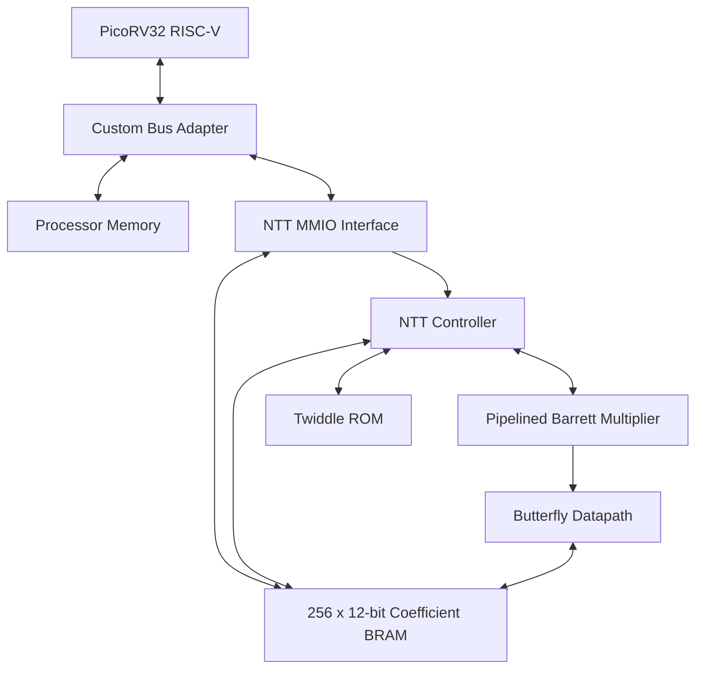

# RISC-V Integrated Hardware Accelerator for NTT-Based Post-Quantum Cryptography

A PicoRV32-integrated hardware accelerator implementing a 256-point forward Number Theoretic Transform (NTT) using ML-KEM parameters. The design combines a pipelined modular arithmetic datapath, synchronous BRAM coefficient storage, memory-mapped control, firmware integration, and FPGA implementation evaluation.

**Technologies:** Verilog · PicoRV32 · C · Python · Icarus Verilog · Yosys · nextpnr-ecp5

---

## 1. Overview

The Number Theoretic Transform is an important polynomial-arithmetic operation used in lattice-based cryptography. This project explores its hardware acceleration through a custom NTT engine connected to a PicoRV32 RISC-V processor.

The accelerator implements a forward 256-point transform using:

| Parameter | Value |
|---|---:|
| Transform length | 256 |
| Modulus | 3329 |
| Coefficient width | 12 bits |
| Root parameter | 17 |
| Twiddle ROM | 128 entries |
| Transform stages | 7 |
| Butterfly operations | 896 |

The implementation is functionally verified using RTL testbenches, Python reference models, independent golden comparisons, and processor-level firmware simulations.

## 2. Architecture

The system consists of three main parts:

1. **PicoRV32 processor:** Executes firmware and controls accelerator transactions.
2. **MMIO and memory interface:** Transfers coefficients and exposes control and status registers.
3. **NTT engine:** Performs the transform using shared coefficient memory, twiddle ROM, and a pipelined butterfly datapath.

### Coefficient storage and datapath

The engine uses a shared synchronous 256 × 12-bit, 1-read/1-write coefficient BRAM. The transform operates in place, reusing the same memory for intermediate and final coefficients.

A 128-entry ROM supplies precomputed twiddle factors. The controller sequences a shared butterfly datapath through the seven transform stages.

### Butterfly operation

For input coefficients `a` and `b`, twiddle factor `zeta`, and modulus `q = 3329`:

$$
t = (b \times \zeta) \bmod q
$$

$$
u = (a + t) \bmod q
$$

$$
v = (a - t) \bmod q
$$

The butterfly produces output coefficients `u` and `v`.

### Pipelined Barrett multiplier

The modular multiplier computes:

$$
r = (a \times b) \bmod 3329
$$

It uses the Barrett reciprocal constant:

$$
\mu = 5039
$$

The multiplier has an eight-cycle pipeline latency. The NTT controller waits for the multiplication result before proceeding with the corresponding coefficient writes.

## 3. Hardware Implementation

### Main design components

| Component | Responsibility |
|---|---|
| Pipelined Barrett multiplier | Modular multiplication |
| Pipelined NTT engine | Transform scheduling and butterfly execution |
| Coefficient BRAM | Synchronous in-place coefficient storage |
| Twiddle ROM | Precomputed transform constants |
| MMIO controller | Processor-accessible control and data interface |
| PicoRV32 integration | Processor, bus adapter, and memory connection |

The pipelined engine uses the following control states:

`INIT` → `IDLE` → `READ_A` → `READ_B` → `PIPE_START` → `PIPE_WAIT` → `WRITE_U` → `WRITE_V`

The initialization state clears coefficient storage. Processor access is disabled while the transform is running. The processor must reload all 256 input coefficients before starting another independent transform.

## 4. Processor Integration and MMIO

The accelerator is integrated with PicoRV32 through a custom bus adapter and synchronous memory-mapped interface.

**Accelerator base address:** `0x10000000`

| Offset | Access | Function |
|---|---|---|
| `0x000` | Write | CONTROL — bit 0 starts the accelerator |
| `0x004` | Read | STATUS |
| `0x100–0x4FC` | Write | 256 input coefficients |
| `0x500–0x8FC` | Read | 256 output coefficients |

STATUS register:

| Bit | Meaning |
|---|---|
| 0 | Busy |
| 1 | Sticky completion flag |
| 2 | Initialization complete |

The firmware writes the input coefficients, starts the transform, polls the status register, and reads the transformed coefficients.

This is a custom synchronous MMIO interface, not an AXI, AHB, or Wishbone implementation.

## 5. Verification

Verification covers arithmetic correctness, transform execution, memory access, and processor integration.

### Results

| Verification | Result |
|---|---|
| Python reference comparison with `kyber-py` | 6/6 passed |
| Independent reference checks | 5/5 passed |
| Barrett modular arithmetic | 11,082,241 coefficient pairs passed |
| Pipelined multiplier regression | 10,000 transactions passed |
| Pipelined multiplier latency | 8 cycles |
| Pipelined NTT regression | 4 input patterns passed |
| Pipelined NTT coefficient comparisons | 1,024 passed |
| Independent nonzero golden comparison | Zero mismatches |
| Zero-input golden comparison | Zero mismatches |

The Barrett exhaustive test covers all valid coefficient pairs for the optimized modular arithmetic implementation. It is distinct from the 10,000-transaction pipelined multiplier regression.

### PicoRV32 integration

Firmware-driven simulations were completed for:

- Zero input
- Nonzero input
- Near-modulus input
- Deterministic random input

All 256 output coefficients matched the expected results in each of these four integration tests.

These results establish functional simulation correctness for the tested configurations; they do not represent physical FPGA board validation.

## 6. FPGA Implementation Results

The design was synthesized using Yosys and evaluated through ECP5 placement and routing using nextpnr.

**Target:** Lattice ECP5 LFE5U-85K, CABGA381, speed grade 6.

### Resource utilization

| Resource | Result |
|---|---:|
| DP16KD block RAM | 1 |
| MULT18X18D | 1 |
| LUT4 | 634 |
| TRELLIS_FF | 438 |
| Routed combinational cells | 1,064 |

### Timing comparison

| Architecture | Routed Fmax |
|---|---:|
| Original BRAM `%Q` implementation | 15.2149 MHz |
| Barrett implementation | 25.9882 MHz |
| Shift/add Barrett implementation | 27.0746 MHz |
| Pipelined Barrett implementation | **78.7836 MHz** |

The final pipelined implementation reports approximately 5.18× the routed Fmax of the original implementation.

The final run used a requested clock of 50 MHz with `--lpf-allow-unconstrained` and `--timing-allow-fail`. The reported Fmax is an implementation-tool estimate, not a claim of complete timing closure or measured board frequency.

No physical FPGA board validation or power measurement has been performed.

## 7. Repository Organization

| Directory | Contents |
|---|---|
| `rtl/` | NTT engine, pipelined arithmetic, coefficient BRAM, twiddle ROM, and MMIO modules |
| `integration/` | PicoRV32 core, bus adapter, processor memory, integration top, and testbenches |
| `firmware/` | C firmware, startup code, linker script, test vectors, and expected outputs |
| `software/` | Python reference implementation, `kyber-py` comparisons, golden-vector and test-vector utilities |
| `testbench/` | Arithmetic, butterfly, and transform verification testbenches |

The repository includes the earlier implementation variants as well as the final pipelined BRAM implementation. The final architecture and results described above refer to the pipelined implementation.

## 8. Tools

| Area | Tools |
|---|---|
| RTL | Verilog |
| Processor | PicoRV32 |
| Firmware | C, RISC-V assembly |
| Simulation | Icarus Verilog |
| Reference verification | Python, `kyber-py` |
| Synthesis | Yosys |
| FPGA implementation | nextpnr-ecp5 |
| Version control | Git, GitHub |

## 9. Scope and Limitations

**Implemented:** A processor-integrated 256-point forward NTT accelerator using ML-KEM-related parameters, pipelined Barrett multiplication, synchronous coefficient BRAM, MMIO control, firmware execution, and functional verification.

**Not claimed:** A complete ML-KEM or FIPS 203 implementation, inverse NTT, physical FPGA board validation, measured power consumption, or silicon validation.

The project focuses on the hardware architecture and functional evaluation of an NTT accelerator; it is not a production cryptographic device.

---

*RISC-V · Hardware Acceleration · Post-Quantum Cryptography*
