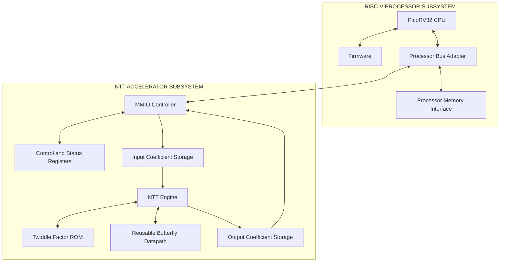
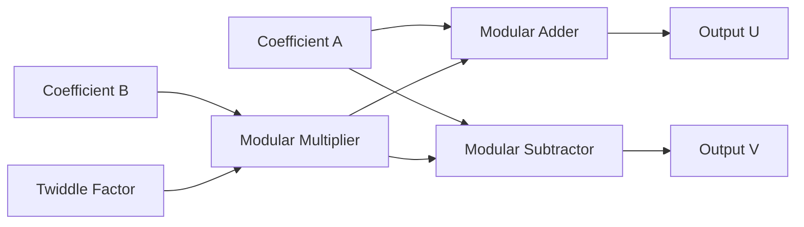
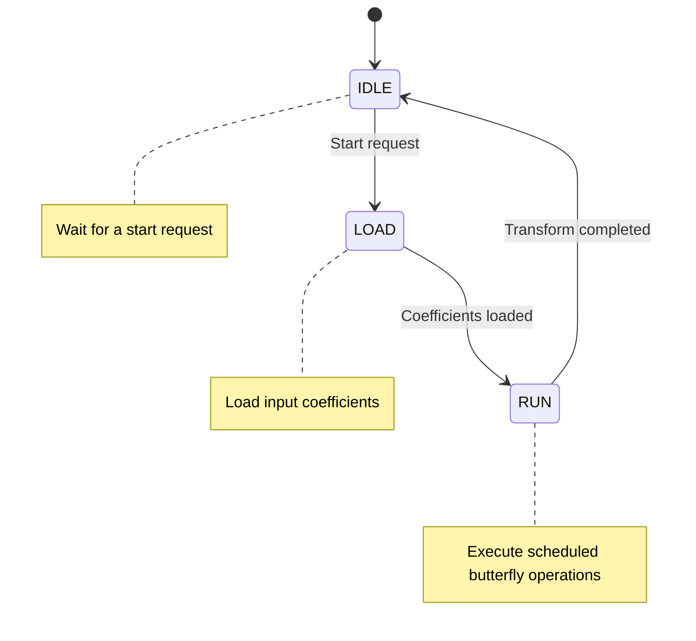
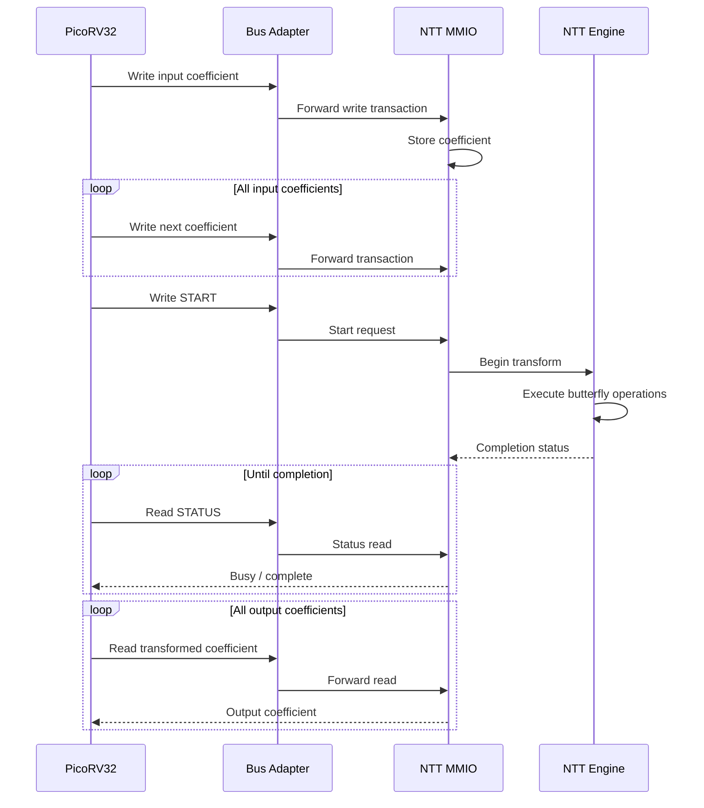
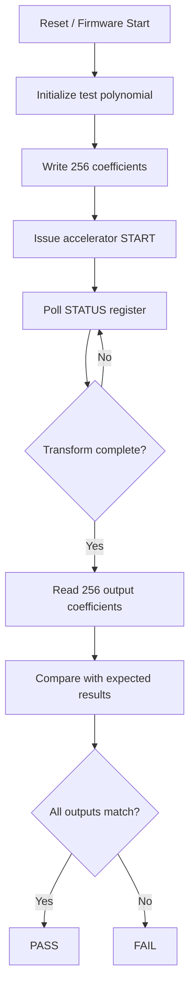
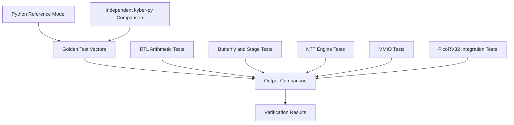

# RISC-V Integrated Hardware Accelerator for NTT-Based Post-Quantum Cryptography

**A processor-integrated hardware accelerator for polynomial Number Theoretic Transform (NTT) computation, designed around ML-KEM parameters and evaluated through RTL simulation, RISC-V integration, and FPGA implementation tools.**

<p align="center">

  **Verilog RTL · PicoRV32 · Memory-Mapped I/O · Python Verification · Yosys · nextpnr**

</p>

---

## 1. Project Overview

Post-quantum cryptography (PQC) algorithms are designed to remain secure against attacks from both classical and quantum computers. One of the standardized post-quantum key encapsulation mechanisms is **ML-KEM (Module-Lattice-Based Key-Encapsulation Mechanism)**, specified in FIPS 203.

Polynomial arithmetic is a fundamental computational component of ML-KEM. The Number Theoretic Transform (NTT) enables efficient polynomial-domain operations and is therefore an important candidate for hardware acceleration.

This project develops a **RISC-V-integrated NTT hardware accelerator** using Verilog RTL and a PicoRV32 processor.

The accelerator performs a forward 256-coefficient transform over the finite field with modulus:

\[
q=3329
\]

It includes dedicated modular arithmetic units, a reusable butterfly datapath, precomputed twiddle factors, an accelerator controller, and a synchronous memory-mapped interface.

The complete subsystem is functionally evaluated using Python reference models, golden test vectors, Icarus Verilog simulation, processor-level firmware tests, and FPGA synthesis and place-and-route tools.

### Project Highlights

- A 256-coefficient forward NTT hardware engine.
- Dedicated modular addition, subtraction, and multiplication units.
- A 128-entry precomputed twiddle-factor ROM.
- A reusable butterfly datapath sequenced across transform stages.
- A synchronous MMIO interface for processor control and coefficient transfers.
- Integration with the PicoRV32 RISC-V processor.
- Firmware-driven accelerator execution and output verification.
- Independent software-reference comparisons using `kyber-py`.
- FPGA synthesis and ECP5 placement-and-routing evaluation.

---

## 2. System Architecture

The design is organized into three major subsystems:

1. **Processor subsystem:** Executes firmware and manages accelerator transactions.
2. **Accelerator interface:** Handles control registers, status reporting, and coefficient transfers.
3. **NTT computation engine:** Performs modular arithmetic and transform operations.

### High-Level Architecture



The processor and accelerator operate as separate hardware blocks. The processor handles instruction execution, data movement, and control, while the accelerator performs the transform computation.

### Accelerator Datapath

The NTT engine uses a shared butterfly datapath rather than instantiating a separate butterfly for every coefficient pair.



The butterfly computes modular sum and difference operations using a twiddle-factor multiplication.

\[
t=(b\cdot\zeta)\bmod q
\]

\[
u=(a+t)\bmod q
\]

\[
v=(a-t)\bmod q
\]

where:

- \(a,b\) are input coefficients.
- \(\zeta\) is the selected twiddle factor.
- \(q=3329\) is the modulus.
- \(u,v\) are the butterfly outputs.

---

## 3. NTT Engine Design

### Transform Parameters

| Parameter | Value |
|---|---|
| Transform length | 256 coefficients |
| Modulus \(q\) | 3329 |
| Coefficient width | 12 bits |
| Twiddle-generation root | 17 |
| Twiddle ROM depth | 128 entries |
| Transform schedule | Cooley–Tukey DIT |
| Controller states | IDLE, LOAD, RUN |
| Butterfly architecture | One reusable datapath |

### Main Hardware Components

| Module | Responsibility |
|---|---|
| `mlkem_ntt_engine.v` | Coordinates coefficient storage, transform scheduling, and butterfly execution |
| `modular_adder.v` | Performs modular addition |
| `modular_subtractor.v` | Performs modular subtraction |
| `modular_multiplier.v` | Performs modular multiplication |
| `ntt_butterfly.v` | Implements the modular butterfly datapath |
| `ntt_butterfly_basic.v` | Basic butterfly implementation |
| `ntt_twiddle_rom.v` | Stores precomputed twiddle factors |
| `ntt_twiddle_lookup.v` | Provides twiddle-factor lookup functionality |
| `ntt_stage.v` | Stage-level transform logic |
| `ntt_stage1.v` | First stage implementation |
| `ntt_stage2.v` | Second stage implementation |
| `ntt_stage3.v` | Third stage implementation |
| `ntt_accelerator_mmio.v` | Processor-accessible accelerator register interface |

### Modular Arithmetic

The arithmetic units operate over the finite field:

\[
\mathbb{Z}_{3329}
\]

**Modular addition**

\[
r=(a+b)\bmod 3329
\]

The adder performs addition followed by conditional modular correction.

**Modular subtraction**

\[
r=(a-b)\bmod 3329
\]

The subtractor performs subtraction followed by conditional correction.

**Modular multiplication**

\[
r=(a\times b)\bmod 3329
\]

The multiplier uses a 24-bit intermediate product before modular reduction.

### Twiddle Factor Generation

The design uses a precomputed ROM containing 128 twiddle factors derived from the parameter:

\[
\zeta=17
\]

The ROM uses bit-reversed indexing for the transform schedule.

Precomputing these values avoids generating powers of the root during accelerator execution.

### Controller Operation

The engine uses three main control states:



| State | Function |
|---|---|
| `IDLE` | Waits for an accelerator start request |
| `LOAD` | Loads and prepares the input coefficients |
| `RUN` | Executes the scheduled transform operations |

The engine uses its controller to sequence the reusable butterfly across the transform schedule.

---

## 4. Processor Integration

A major part of this project is integrating the accelerator with a real RISC-V processor core rather than evaluating the NTT engine in isolation.

The processor integration uses **PicoRV32**, a compact RISC-V CPU implementation.

### Processor-to-Accelerator Data Flow



### Processor Integration Components

| File | Description |
|---|---|
| `picorv32.v` | PicoRV32 processor core |
| `picorv32_ntt_bus_adapter.v` | Connects processor bus transactions to the accelerator and memory |
| `picorv32_ntt_memory.v` | Processor memory interface |
| `picorv32_ntt_top.v` | Top-level processor and accelerator integration |
| `picorv32_ntt_integration_tb.v` | Processor-level integration testbench |
| `picorv32_ntt_nonzero_tb.v` | Nonzero-input integration testbench |
| `picorv32_ntt_near_modulus_tb.v` | Near-modulus integration testbench |
| `ntt_load_reduction_tb.v` | Coefficient normalization verification testbench |

### MMIO Register Interface

The accelerator is controlled using a synchronous memory-mapped interface.

Interface signals:

| Signal | Direction | Description |
|---|---|---|
| `clk` | Input | System clock |
| `rst` | Input | Reset |
| `wr_en` | Input | Write enable |
| `rd_en` | Input | Read enable |
| `addr[11:0]` | Input | Register address |
| `wdata[31:0]` | Input | Write data |
| `rdata[31:0]` | Output | Read data |

This is a simple synchronous MMIO interface. It is not an AXI, AHB, or Wishbone implementation.

#### Accelerator Register Map

| Register Offset | Access | Description |
|---|---|---|
| `0x000` | Write | CONTROL: bit 0 starts the accelerator when idle |
| `0x004` | Read | STATUS: bit 0 indicates busy; bit 1 indicates completion |
| `0x100–0x4FC` | Write | 256 input coefficient registers |
| `0x500–0x8FC` | Read | 256 output coefficient registers |

Each coefficient occupies a 32-bit word-aligned register. The coefficient value is stored in bits `[11:0]`.

#### PicoRV32 Address Map

The accelerator is decoded at base address `0x1000` in the processor integration.

| Processor Address | Function |
|---|---|
| `0x1000` | CONTROL |
| `0x1004` | STATUS |
| `0x1100–0x14FC` | Input coefficients |
| `0x1500–0x18FC` | Output coefficients |

---

## 5. Firmware and Software Verification

The processor firmware performs the complete accelerator transaction.

### Firmware Execution Flow



The firmware is responsible for:

1. Initializing the input polynomial.
2. Writing the input coefficients to the accelerator.
3. Starting the transform.
4. Polling the status register.
5. Reading all 256 output coefficients.
6. Comparing hardware outputs against expected results.

### Software Reference Environment

Python reference models and generated test vectors are used to validate the hardware implementation.

The project also uses `kyber-py` for independent reference comparisons.

The software directory contains:

- Reference NTT implementation.
- Independent comparison scripts.
- Golden-vector generation.
- Stress-vector generation.
- Twiddle ROM generation.
- Verilog test-vector generation.
- Random testbench generation.

This provides a software-based verification path independent of the processor-level RTL simulation.

---

## 6. Verification Methodology and Results

Verification was performed at multiple levels to identify errors in arithmetic, butterfly operation, transform execution, MMIO behavior, and processor integration.

### Verification Overview



### 6.1 Software Reference Verification

| Test | Result |
|---|---|
| Python reference comparison with `kyber-py` | PASS — 6/6 vectors |
| Independent reference checks | PASS — 5/5 vectors |
| Stress-vector generation | PASS — 4/4 vectors |
| HEX vector export | PASS — 8/8 memory files |
| Random testbench generation | PASS |

### 6.2 Arithmetic and Butterfly Verification

The modular arithmetic units were tested with boundary values and representative input combinations.

The verification covered:

- Modular addition.
- Modular subtraction.
- Modular multiplication.
- Butterfly sum and difference outputs.
- Twiddle-factor multiplication.

### 6.3 NTT Stage Verification

The stage-level testbenches verified the implemented first three NTT stages.

The recorded regression covered:

- Four input patterns.
- 384 butterfly operations per input pattern.
- **1,536 butterfly operations in total.**
- Zero reported mismatches.

This stage-level result is separate from the full NTT engine and processor integration regressions.

### 6.4 Full NTT Engine Verification

The complete NTT engine was evaluated using four input patterns:

| Input Pattern | Purpose |
|---|---|
| All-zero | Checks zero-input behavior |
| Single-nonzero | Checks a sparse input case |
| Near-modulus | Checks coefficient boundary handling |
| Deterministic random | Checks varied coefficient combinations |

All 256 output coefficients for each tested pattern were compared against the corresponding software-generated golden reference.

**Result: All four recorded test patterns passed with zero output mismatches.**

### 6.5 MMIO Verification

The MMIO interface was tested for:

- Input coefficient writes.
- Accelerator start control.
- Busy-status reporting.
- Completion-status reporting.
- Output coefficient readback.
- Comparison with expected NTT results.

The tested regression patterns completed without output mismatches.

### 6.6 PicoRV32 Integration Verification

The processor-level regression suite covered five input patterns.

| Test Pattern | Result |
|---|---|
| All-zero | All 256 outputs compared |
| Deterministic nonzero | All 256 outputs compared |
| Single-nonzero | All 256 outputs compared |
| Near-modulus | All 256 outputs compared |
| Deterministic random | All 256 outputs compared |

The recorded project integration tests passed for all five patterns.

Additional local regression runs confirmed:

| Local Test | Result |
|---|---|
| Nonzero-input processor integration | PASS — 256/256 outputs matched |
| Near-modulus processor integration | PASS — 256/256 outputs matched |
| Input coefficient normalization | PASS — 256/256 coefficients verified |

Recorded firmware completion points:

- Nonzero-input integration: cycle **13,315**.
- Near-modulus integration: cycle **12,941**.

Both runs reported successful golden-reference comparisons.

The processor core, bus adapter, memory interface, top-level integration, firmware source, HEX files, and processor-level testbenches are included in the repository.

---

## 7. FPGA Synthesis and Implementation Evaluation

The accelerator was evaluated using open-source FPGA implementation tools.

The implementation flow used:

- **Yosys** for RTL synthesis.
- **nextpnr-ecp5** for ECP5 placement and routing.

The purpose of this evaluation was to estimate hardware resource usage and analyze the timing characteristics of the integrated accelerator design.

### FPGA Target Configuration

| Parameter | Configuration |
|---|---|
| FPGA family | Lattice ECP5 |
| Device class | 85K |
| Package | CABGA381 |
| Speed grade | 6 |
| Requested clock frequency | 50 MHz |

### Synthesis Resource Utilization

| Resource | Reported Utilization |
|---|---:|
| LUT4 | 23,707 |
| TRELLIS_FF | 6,194 |
| MULT18X18D | 2 |
| DP16KD block RAM | 0 |

The coefficient storage was mapped to registers rather than dedicated ECP5 block RAM in the evaluated implementation.

### Place-and-Route Timing Results

| Metric | Result |
|---|---:|
| Requested frequency | 50 MHz |
| Tool-reported Fmax | 11.318 MHz |
| Timing target | Not met |
| Critical path delay | 88.354 ns |
| Routing contribution | 59.208 ns |
| Routing share of critical path | Approximately 67% |

### Critical Path Analysis

The reported critical path extended from the NTT engine's group-start register to a coefficient-memory register.

The path included butterfly multiplication and coefficient-memory write logic.


The timing report showed that routing delay contributed approximately 67% of the critical path delay.

This indicates that both datapath logic and interconnect organization are important targets for future optimization.

### Interpretation of Results

The implementation achieved a successful synthesis and placement-and-routing evaluation, but it did **not** meet the requested 50 MHz timing target.

The reported Fmax of 11.318 MHz is a tool-estimated result for the selected target and implementation configuration. It should not be interpreted as a measurement from a physical FPGA board.

No physical FPGA board validation, power measurement, or silicon measurement is claimed.

---

## 8. Repository Structure

```text
riscv-ntt-accelerator/
│
├── README.md
├── .gitignore
│
├── rtl/
│   ├── mlkem_ntt_engine.v
│   ├── modular_adder.v
│   ├── modular_subtractor.v
│   ├── modular_multiplier.v
│   ├── ntt_butterfly.v
│   ├── ntt_butterfly_basic.v
│   ├── ntt_twiddle_rom.v
│   ├── ntt_twiddle_lookup.v
│   ├── ntt_accelerator_mmio.v
│   ├── ntt_stage.v
│   ├── ntt_stage1.v
│   ├── ntt_stage2.v
│   └── ntt_stage3.v
│
├── integration/
│   ├── picorv32.v
│   ├── picorv32_ntt_bus_adapter.v
│   ├── picorv32_ntt_memory.v
│   ├── picorv32_ntt_top.v
│   ├── picorv32_ntt_integration_tb.v
│   ├── picorv32_ntt_nonzero_tb.v
│   ├── picorv32_ntt_near_modulus_tb.v
│   └── ntt_load_reduction_tb.v
│
├── firmware/
│   ├── main.c
│   ├── main_zero_test.c
│   ├── main_single_nonzero.c
│   ├── main_nonzero_test.c
│   ├── main_near_modulus.c
│   ├── main_random_test.c
│   ├── start.S
│   ├── linker.ld
│   ├── firmware.hex
│   ├── firmware_near_modulus.hex
│   ├── expected_ntt.hex
│   ├── expected_ntt_near_modulus.hex
│   ├── expected_ntt_random.hex
│   ├── test_vectors.h
│   ├── test_vectors_near_modulus.h
│   ├── test_vectors_random.h
│   ├── random_input.h
│   ├── random_input.txt
│   ├── random_input_random.h
│   ├── random_input_random.txt
│   ├── bin_to_mem.py
│   └── bin_to_mem_near_modulus.py
│
├── software/
│   ├── compare_with_kyber.py
│   ├── ntt_reference.py
│   ├── ntt_independent_check.py
│   ├── generate_golden_vector.py
│   ├── generate_stress_vectors.py
│   ├── export_stress_vectors.py
│   ├── generate_twiddle_rom.py
│   ├── generate_verilog_vector.py
│   ├── generate_random_testbench.py
│   ├── expected_ntt_sequential.txt
│   ├── expected_ntt_verilog.txt
│   └── stress_vectors/
│       ├── all_zero.json
│       ├── deterministic_random.json
│       ├── near_modulus.json
│       ├── single_nonzero.json
│       ├── deterministic_random_testbench.sv
│       └── verilog/
│           ├── all_zero_input.mem
│           ├── all_zero_expected.mem
│           ├── deterministic_random_input.mem
│           ├── deterministic_random_expected.mem
│           ├── near_modulus_input.mem
│           ├── near_modulus_expected.mem
│           ├── single_nonzero_input.mem
│           └── single_nonzero_expected.mem
│
└── testbench/
    ├── modular_adder_tb.v
    ├── modular_subtractor_tb.v
    ├── modular_multiplier_tb.v
    ├── ntt_butterfly_basic_tb.v
    ├── ntt_butterfly_tb.v
    └── ntt_stage_tb.v
```

Generated `.bin`, `.elf`, and `.map` build artifacts are excluded from version control. The tracked HEX files are retained for firmware initialization and simulation.

---

## 9. Reproducing the Verification

### Prerequisites

- Python 3.8 or later.
- Icarus Verilog (`iverilog` and `vvp`).
- Yosys.
- nextpnr with ECP5 support.
- `kyber-py` for independent software-reference comparison.

Install the Python reference package:

```bash
pip install kyber-py
```

### Python Verification

Run from the repository root:

```bash
python software/compare_with_kyber.py

python software/ntt_independent_check.py

python software/generate_stress_vectors.py

python software/export_stress_vectors.py

python software/generate_random_testbench.py
```

### RTL Arithmetic Unit Simulations

**Modular adder**

```bash
iverilog -g2012 -o results/adder.vvp rtl/modular_adder.v testbench/modular_adder_tb.v
vvp results/adder.vvp
```

**Modular subtractor**

```bash
iverilog -g2012 -o results/subtractor.vvp rtl/modular_subtractor.v testbench/modular_subtractor_tb.v
vvp results/subtractor.vvp
```

**Modular multiplier**

```bash
iverilog -g2012 -o results/multiplier.vvp rtl/modular_multiplier.v testbench/modular_multiplier_tb.v
vvp results/multiplier.vvp
```

**Butterfly datapath**

```bash
iverilog -g2012 -o results/butterfly.vvp rtl/modular_adder.v rtl/modular_subtractor.v rtl/modular_multiplier.v rtl/ntt_butterfly.v testbench/ntt_butterfly_tb.v
vvp results/butterfly.vvp
```

### PicoRV32 Integration Simulation

The following example runs the nonzero-input processor integration test.

```bash
iverilog -g2012 -o integration_test.vvp integration/picorv32.v integration/picorv32_ntt_bus_adapter.v integration/picorv32_ntt_memory.v rtl/modular_adder.v rtl/modular_subtractor.v rtl/modular_multiplier.v rtl/ntt_butterfly.v rtl/ntt_twiddle_rom.v rtl/mlkem_ntt_engine.v rtl/ntt_accelerator_mmio.v integration/picorv32_ntt_top.v integration/picorv32_ntt_integration_tb.v

vvp integration_test.vvp
```

Near-modulus integration test:

```bash
iverilog -g2012 -o near_modulus_test.vvp integration/picorv32.v integration/picorv32_ntt_bus_adapter.v integration/picorv32_ntt_memory.v rtl/modular_adder.v rtl/modular_subtractor.v rtl/modular_multiplier.v rtl/ntt_butterfly.v rtl/ntt_twiddle_rom.v rtl/mlkem_ntt_engine.v rtl/ntt_accelerator_mmio.v integration/picorv32_ntt_top.v integration/picorv32_ntt_near_modulus_tb.v

vvp near_modulus_test.vvp
```

The integration directory also contains the nonzero-input, load-normalization, and processor-level testbenches.

---

## 10. Engineering Challenges and Design Considerations

Several implementation considerations emerged during development and FPGA evaluation.

### Reusable Datapath

Using one reusable butterfly reduces the number of replicated arithmetic datapaths. However, the controller must sequence the operations and manage coefficient access correctly.

### Coefficient Storage

The current coefficient storage maps to registers rather than dedicated ECP5 block RAM in the evaluated implementation.

Dynamic coefficient indexing, parallel coefficient loading, and output access are important considerations for a future memory architecture redesign.

### Timing Performance

The placement-and-routing report identifies routing as the largest contributor to the critical path.

Potential improvements include:

- Reducing long interconnect paths.
- Improving coefficient-memory organization.
- Introducing pipeline stages where appropriate.
- Optimizing control and write-enable logic.
- Evaluating alternative datapath schedules.

### Verification Across Abstraction Levels

Testing only the arithmetic units would not establish that the processor can correctly control the accelerator.

The project therefore verifies the design at multiple levels:

- Arithmetic modules.
- Butterfly datapath.
- NTT stages.
- Complete NTT engine.
- MMIO interface.
- Processor-level firmware integration.
- Independent software-reference comparison.

---

## 11. Current Scope and Limitations

### Implemented

- Forward 256-coefficient NTT engine.
- Modular arithmetic datapath.
- Twiddle-factor ROM.
- Reusable butterfly architecture.
- Synchronous MMIO interface.
- PicoRV32 processor integration.
- Firmware-driven accelerator execution.
- Python reference and golden-vector verification.
- RTL and processor-level functional simulations.
- ECP5 synthesis and placement-and-routing evaluation.

### Not Yet Implemented or Validated

- Complete ML-KEM implementation.
- Complete inverse NTT and all remaining cryptographic operations required for FIPS 203.
- Physical FPGA board validation.
- Timing closure at the requested 50 MHz.
- Physical power measurements.
- Silicon-level validation.
- Dedicated block RAM mapping for coefficient storage.

**Cryptographic scope:** This project is an NTT hardware-acceleration research and engineering implementation using ML-KEM-related parameters. It is not a complete FIPS 203 implementation and should not be treated as a production cryptographic device.

---

## 12. Future Development

The following improvements are potential next development phases:

| Area | Planned Direction |
|---|---|
| Timing optimization | Reduce critical-path delay and improve achievable frequency |
| Memory architecture | Investigate efficient block RAM inference |
| Datapath | Explore pipelining and improved coefficient access |
| Transform support | Add inverse NTT functionality |
| Processor integration | Explore standardized SoC interconnects such as AXI4-Lite |
| Verification | Expand automated regression coverage |
| FPGA evaluation | Perform physical board validation |
| Power analysis | Evaluate power consumption using supported implementation tools |

---

## 13. Tools and Technologies

| Category | Tools |
|---|---|
| Hardware description | Verilog |
| Processor | PicoRV32 RISC-V |
| Simulation | Icarus Verilog |
| Synthesis | Yosys |
| FPGA place and route | nextpnr-ecp5 |
| Software reference | Python |
| Independent reference | kyber-py |
| Firmware | C and RISC-V assembly |
| Version control | Git and GitHub |

---

## 14. License and Academic Use

This repository is intended for academic, educational, and engineering evaluation.

A formal project-level open-source license has not yet been selected. Third-party components, including the PicoRV32 core and reference software packages, retain their respective licensing terms. Consult their original repositories and package distributions before redistribution.

---

<p align="center">

  **RISC-V x Hardware Acceleration x Post-Quantum Cryptography**

  *Exploring hardware architectures for efficient polynomial computation.*

</p>
