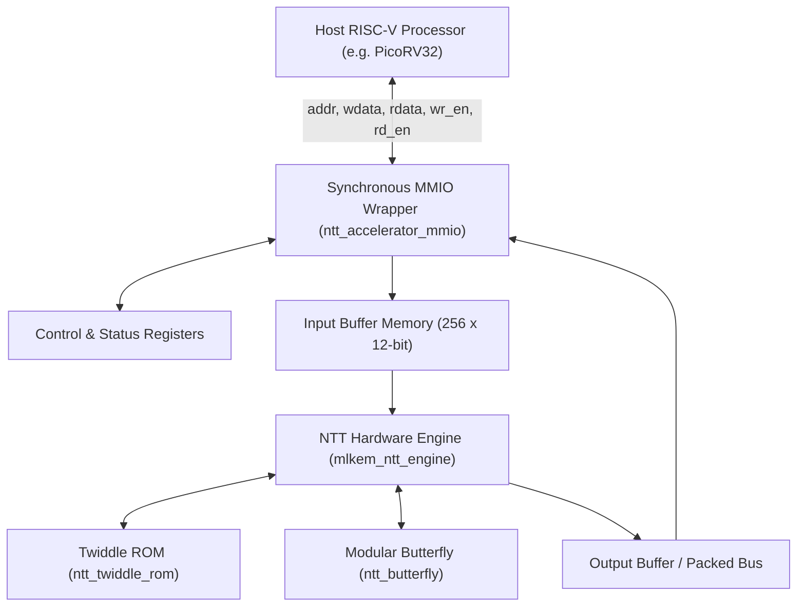
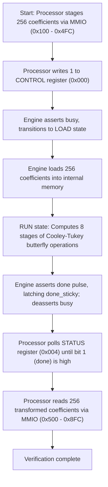
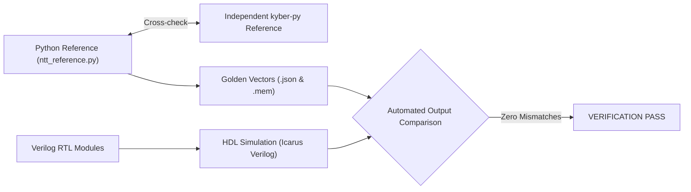

# RISC-V Integrated Hardware Accelerator for NTT-Based Post-Quantum Cryptography

A hardware accelerator for the Number Theoretic Transform (NTT) over the prime field $\mathbb{Z}_q$ with $q = 3329$, integrated via a synchronous Memory-Mapped I/O (MMIO) register interface for RISC-V processor control.

---

## Overview

Post-Quantum Cryptography (PQC) standards such as ML-KEM (formerly Kyber, standardized in FIPS 203) rely heavily on polynomial multiplications in the ring $\mathcal{R}_q = \mathbb{Z}_q[X]/(X^{256} + 1)$ with modulus $q = 3329$. The Number Theoretic Transform (NTT) accelerates these polynomial multiplications from $O(N^2)$ schoolbook complexity down to $O(N \log N)$.

This project implements and verifies:
1. **Verilog RTL Accelerator Core:** A 256-coefficient NTT computation engine using modular arithmetic and precomputed twiddle factors.
2. **Synchronous MMIO Wrapper:** A memory-mapped register interface providing control, status polling, input coefficient staging, and output coefficient readback.
3. **Software Verification Suite:** Python reference models validated against `kyber-py`, accompanied by golden vector generators, stress tests, and automated testbenches.

---

## Key Features

- **256-Coefficient Transform:** Computes forward NTT for degree-255 polynomials over modulus $q = 3329$.
- **Modular Arithmetic Units:** Constant-cycle modular addition, subtraction, and multiplication tailored for $q = 3329$.
- **Twiddle Factor ROM:** 128 precomputed twiddle powers derived from primitive root $\zeta = 17 \pmod{3329}$ with bit-reversed indexing.
- **Synchronous MMIO Interface:** Simple, robust memory-mapped interface compatible with standard microprocessor memory buses.
- **Independent Cross-Verification:** 100% agreement against independent reference implementations (`kyber-py` and standalone arithmetic).
- **Comprehensive Test Vectors:** Verified corner cases including all-zeros, impulse, sequential integers, near-modulus boundary values, and deterministic pseudorandom data.

---

## System Architecture

The accelerator subsystem communicates with a controlling microprocessor (such as PicoRV32) over a synchronous memory-mapped interface.



### Accelerator Execution Flow

The processor drives transform execution through memory writes and status register polling:



---

## Hardware Architecture & NTT Parameters

| Parameter | Specification | Description |
| :--- | :--- | :--- |
| **Transform Length ($N$)** | 256 | Number of polynomial coefficients |
| **Modulus ($q$)** | 3329 | Prime modulus for Kyber / ML-KEM |
| **Data Width** | 12 bits | $\lceil \log_2(3329) \rceil = 12$ bits per coefficient |
| **Primitive Root ($\zeta$)** | 17 | Root of unity where $\zeta^{256} \equiv 1 \pmod{3329}$ |
| **Twiddle ROM Size** | 128 entries | Precalculated powers $\zeta^{\text{rev}_7(k)} \pmod{3329}$ |
| **Transform Schedule** | Cooley-Tukey DIT | 8 stages with group lengths halving from 128 to 1 |
| **FSM States** | `IDLE`, `LOAD`, `RUN` | Single reusable butterfly datapath sequenced over clock cycles |

### Arithmetic Units

- **`modular_adder`:** Computes $(a + b) \pmod{3329}$ using single-stage conditional subtract $(a + b \ge q \ ?\ a + b - q : a + b)$.
- **`modular_subtractor`:** Computes $(a - b) \pmod{3329}$ using conditional add $(a \ge b \ ?\ a - b : a + q - b)$.
- **`modular_multiplier`:** Computes $(a \times b) \pmod{3329}$ over 24-bit product width.
- **`ntt_butterfly`:** Computes Cooley-Tukey butterfly outputs:
  $$u = (a + b \cdot \zeta) \pmod q$$
  $$v = (a - b \cdot \zeta) \pmod q$$

---

## MMIO Register Map

The MMIO wrapper (`ntt_accelerator_mmio`) uses a clean synchronous memory-mapped interface:
* Inputs: `clk`, `rst`, `wr_en`, `rd_en`, `addr[11:0]`, `wdata[31:0]`
* Outputs: `rdata[31:0]`

All addresses are word-aligned (`addr[1:0] == 2'b00`). This is a simple memory-mapped interface (not AXI, AHB, or Wishbone):

| Register Offset | Access | Name | Bit Fields & Description |
| :--- | :---: | :--- | :--- |
| `0x000` | Write | **CONTROL** | `Bit [0]`: Write `1` to trigger NTT start when idle. Automatically pulses the engine start line and clears `done_sticky`. |
| `0x004` | Read | **STATUS** | `Bit [0]`: `busy` (1 while transform computation is active)<br>`Bit [1]`: `done_sticky` (1 when computation has finished; remains 1 until next start) |
| `0x100` - `0x4FC` | Write | **INPUT COEFFS** | 256 word registers (`0x100 + i * 4`, for $i = 0 \dots 255$). Bits `[11:0]` write input coefficient $i$. |
| `0x500` - `0x8FC` | Read | **OUTPUT COEFFS** | 256 word registers (`0x500 + i * 4`, for $i = 0 \dots 255$). Bits `[11:0]` read transformed coefficient $i$. |

> **Base Address in SoC Integration:** When integrated onto a processor bus, the accelerator block is typically decoded at base address `0x1000`. In that configuration, CPU addresses are `0x1000` (CONTROL), `0x1004` (STATUS), `0x1100`-`0x14FC` (INPUTS), and `0x1500`-`0x18FC` (OUTPUTS).

---

## Repository Structure

```text
riscv-ntt-accelerator/
├── .gitignore
├── README.md
├── rtl/
│   ├── mlkem_ntt_engine.v          # 256-coefficient staged NTT engine
│   ├── modular_adder.v             # Modular addition (q = 3329)
│   ├── modular_multiplier.v        # Modular multiplication (q = 3329)
│   ├── modular_subtractor.v        # Modular subtraction (q = 3329)
│   ├── ntt_accelerator_mmio.v      # Synchronous MMIO register wrapper
│   ├── ntt_butterfly.v             # Cooley-Tukey butterfly with twiddle multiplication
│   ├── ntt_butterfly_basic.v       # Basic addition/subtraction butterfly
│   ├── ntt_stage.v                 # Parameterized butterfly stage (and ntt_stage128 wrapper)
│   ├── ntt_stage1.v                # NTT stage 1 structural module
│   ├── ntt_stage2.v                # NTT stage 2 structural module
│   ├── ntt_stage3.v                # NTT stage 3 structural module
│   ├── ntt_twiddle_lookup.v        # Twiddle address lookup module
│   └── ntt_twiddle_rom.v           # 128-entry precomputed twiddle factor ROM
├── software/
│   ├── compare_with_kyber.py       # Cross-verification against kyber-py
│   ├── expected_ntt_sequential.txt # Golden output for sequential test vector
│   ├── expected_ntt_verilog.txt    # Golden output formatted as Verilog assignments
│   ├── export_stress_vectors.py    # Exports JSON test vectors to .mem hex files
│   ├── generate_golden_vector.py   # Generates golden reference files
│   ├── generate_random_testbench.py# Generates self-checking SV testbench
│   ├── generate_stress_vectors.py  # Generates test vectors (zero, impulse, near-modulus, random)
│   ├── generate_twiddle_rom.py     # Generates twiddle ROM Verilog from generator zeta = 17
│   ├── generate_verilog_vector.py  # Generates expected Verilog assignment files
│   ├── ntt_independent_check.py    # Independent reference verification suite
│   ├── ntt_reference.py            # Forward NTT bit-reversal and reference model
│   └── stress_vectors/
│       ├── all_zero.json
│       ├── deterministic_random.json
│       ├── deterministic_random_testbench.sv
│       ├── near_modulus.json
│       ├── single_nonzero.json
│       └── verilog/
│           ├── all_zero_expected.mem
│           ├── all_zero_input.mem
│           ├── deterministic_random_expected.mem
│           ├── deterministic_random_input.mem
│           ├── near_modulus_expected.mem
│           ├── near_modulus_input.mem
│           ├── single_nonzero_expected.mem
│           └── single_nonzero_input.mem
├── testbench/
│   ├── modular_adder_tb.v          # Arithmetic unit testbench
│   ├── modular_multiplier_tb.v     # Arithmetic unit testbench
│   ├── modular_subtractor_tb.v     # Arithmetic unit testbench
│   ├── ntt_butterfly_basic_tb.v    # Basic butterfly unit testbench
│   ├── ntt_butterfly_tb.v          # Twiddle butterfly unit testbench
│   └── ntt_stage_tb.v              # Stage unit testbench (640 butterfly checks)
└── results/
    └── .gitkeep                    # Directory reserved for simulation logs and wave dumps
```

---

## Verification Methodology & Results

Verification follows a multi-tier flow comparing RTL simulation against independent software models:



### 1. Software Reference Verification (Verified in Environment)

The following tests run directly in the environment and have passed 100%:

| Test Suite | Command | Cases Checked | Result |
| :--- | :--- | :---: | :---: |
| **Kyber Reference Comparison** | `python software/compare_with_kyber.py` | 6 vectors | **PASS (6/6)** |
| **Independent NTT Check** | `python software/ntt_independent_check.py` | 5 vectors | **PASS (5/5)** |
| **Stress Vector Generator** | `python software/generate_stress_vectors.py` | 4 vectors (1024 coeffs) | **PASS (4/4)** |
| **Hex Vector Exporter** | `python software/export_stress_vectors.py` | 8 `.mem` files | **PASS (8/8)** |
| **Random Testbench Generator** | `python software/generate_random_testbench.py` | 256 coefficients | **PASS** |

### 2. Historical RTL & Integration Verification (EDA Playground)

The following regression tests were previously executed in EDA Playground using Icarus Verilog:

* **Arithmetic & Butterfly Unit Tests:**
  * `modular_adder_tb.v`, `modular_subtractor_tb.v`, `modular_multiplier_tb.v`: verified modular boundary cases and wrap-around.
  * `ntt_butterfly_basic_tb.v`, `ntt_butterfly_tb.v`: verified addition, subtraction, and twiddle product.
  * `ntt_stage_tb.v`: verified 640 butterfly operations across 5 input patterns with 0 mismatches.
* **Full MMIO Regression Test:**
  * Automated 256-coefficient regression test verified MMIO register write, engine start, completion polling, and output readback against golden vectors with **0 output mismatches**.
* **PicoRV32 CPU Integration Test:**
  * PicoRV32 processor drove input coefficient loading over MMIO, polled status until done, read back transformed coefficients into CPU RAM, and verified all 256 coefficients.

> **Integration Source Status:** The CPU integration tests were conducted inside the EDA Playground cloud simulation environment with `picorv32.v` and a custom playground testbench. Standalone source for `picorv32.v` and the processor-level integration harness is not distributed in this repository; the repository provides the standalone accelerator RTL, unit testbenches, stress vector suite, and Python verification framework.

---

## Reproduction Instructions

### Prerequisites

* Python 3.8+
* Optional: `kyber-py` for independent polynomial reference comparison:
  ```bash
  pip install kyber-py
  ```
* Icarus Verilog (`iverilog`, `vvp`) for RTL simulation.

### Running Python Verification

From the repository root:

```bash
# 1. Run independent comparison against kyber-py
python software/compare_with_kyber.py

# 2. Run standalone algorithmic check
python software/ntt_independent_check.py

# 3. Generate stress vectors and Verilog memory files
python software/generate_stress_vectors.py
python software/export_stress_vectors.py

# 4. Generate the standalone randomized testbench
python software/generate_random_testbench.py
```

### Compilation Dependencies & Testbench Mapping

Under clean single-module-per-file organization, multi-module designs require compiling their constituent dependencies together. In EDA Playground (via the left sidebar file pane) or CLI simulators, include the following source files for each testbench:

| Testbench | Primary Unit Under Test | Required RTL Source Dependencies |
| :--- | :--- | :--- |
| `testbench/modular_adder_tb.v` | `modular_adder` | `rtl/modular_adder.v` |
| `testbench/modular_subtractor_tb.v` | `modular_subtractor` | `rtl/modular_subtractor.v` |
| `testbench/modular_multiplier_tb.v` | `modular_multiplier` | `rtl/modular_multiplier.v` |
| `testbench/ntt_butterfly_basic_tb.v` | `ntt_butterfly_basic` | `rtl/ntt_butterfly_basic.v` |
| `testbench/ntt_butterfly_tb.v` | `ntt_butterfly` | `rtl/modular_multiplier.v`, `rtl/ntt_butterfly.v` |
| `testbench/ntt_stage_tb.v` | `ntt_stage128` (wrapper for `ntt_stage`) | `rtl/modular_multiplier.v`, `rtl/ntt_butterfly.v`, `rtl/ntt_stage.v` |
| `software/stress_vectors/deterministic_random_testbench.sv` | `mlkem_ntt_engine` | `rtl/modular_multiplier.v`, `rtl/ntt_butterfly.v`, `rtl/ntt_twiddle_rom.v`, `rtl/mlkem_ntt_engine.v` |

### Running RTL Unit Simulations

When Icarus Verilog is installed, compile and execute any testbench from the repository root:

```bash
# Run modular arithmetic testbenches
iverilog -g2012 -o results/adder.vvp rtl/modular_adder.v testbench/modular_adder_tb.v
vvp results/adder.vvp

iverilog -g2012 -o results/subtractor.vvp rtl/modular_subtractor.v testbench/modular_subtractor_tb.v
vvp results/subtractor.vvp

iverilog -g2012 -o results/multiplier.vvp rtl/modular_multiplier.v testbench/modular_multiplier_tb.v
vvp results/multiplier.vvp

# Run butterfly testbenches
iverilog -g2012 -o results/butterfly_basic.vvp rtl/ntt_butterfly_basic.v testbench/ntt_butterfly_basic_tb.v
vvp results/butterfly_basic.vvp

iverilog -g2012 -o results/butterfly.vvp rtl/modular_multiplier.v rtl/ntt_butterfly.v testbench/ntt_butterfly_tb.v
vvp results/butterfly.vvp

# Run stage testbench (640 butterfly operations across 5 patterns)
iverilog -g2012 -o results/stage.vvp rtl/modular_multiplier.v rtl/ntt_butterfly.v rtl/ntt_stage.v testbench/ntt_stage_tb.v
vvp results/stage.vvp

# Run full NTT engine deterministic random testbench
iverilog -g2012 -o results/engine.vvp rtl/modular_multiplier.v rtl/ntt_butterfly.v rtl/ntt_twiddle_rom.v rtl/mlkem_ntt_engine.v software/stress_vectors/deterministic_random_testbench.sv
vvp results/engine.vvp
```

---

## Scope, Limitations, and Future Work

* **Simulation Scope:** All verification results establish functional correctness under behavioral RTL simulation. Synthesis timing closure, FPGA place-and-route, area, and power consumption have not been measured on physical silicon or FPGA hardware.
* **Algorithm Scope:** The accelerator computes the forward 256-point NTT over $q = 3329$. While designed for post-quantum cryptographic applications (ML-KEM / Kyber), full specification compliance (including inverse NTT, Montgomery reduction optimizations, rejection sampling, and symmetric primitives) is outside the scope of this hardware block.
* **Future Work:**
  * Implement inverse NTT (INTT) support within the same butterfly datapath.
  * Integrate an AXI4-Lite or Wishbone bus wrapper for broader SoC compatibility.
  * Target synthesis and place-and-route on a Xilinx Artix-7 / UltraScale+ FPGA.
  * Add automated GitHub Actions CI for continuous RTL and Python regression testing.

---

## License

This project is made available for academic and educational evaluation. A formal open-source license will be selected by the project author.
